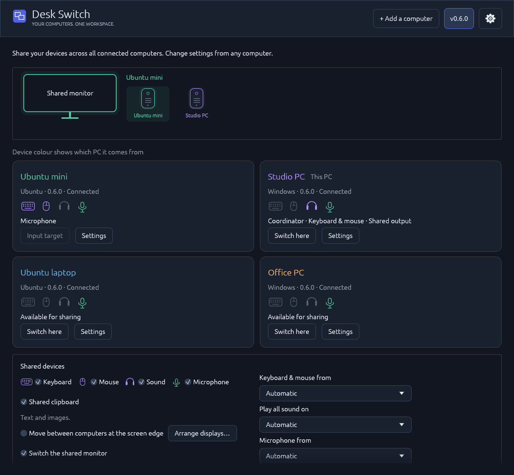
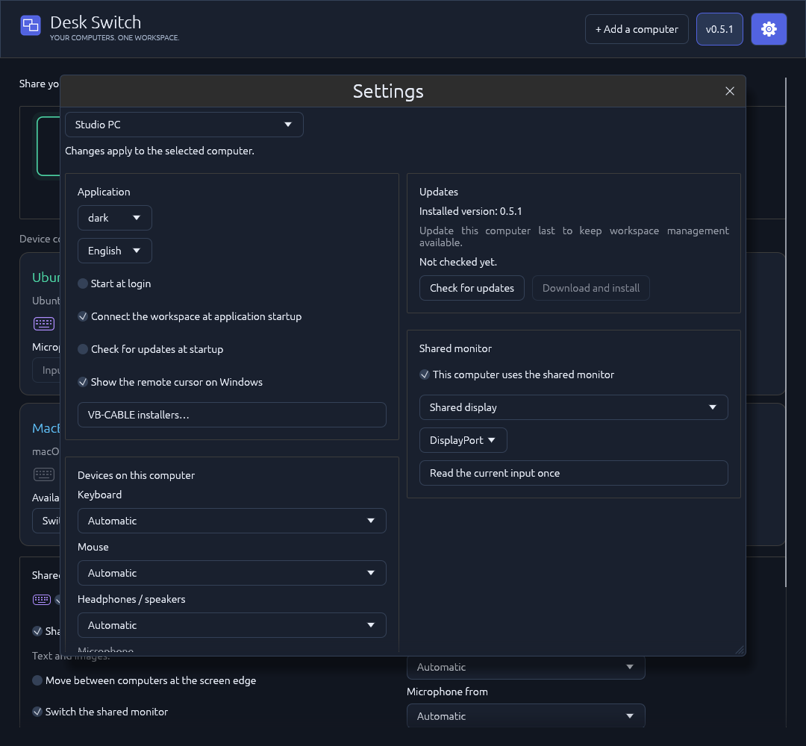
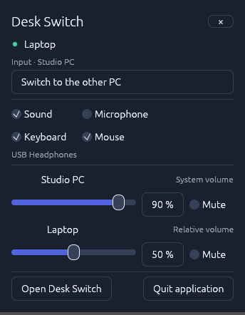

# Desk Switch

Your computers. One workspace. Share a keyboard, mouse, headphones or speakers, microphone and an optional clipboard across **three, four or more computers**. Control the workspace and each computer's settings from any member. Windows and Ubuntu have native adapters; macOS support is experimental and has not been tested on physical hardware. A shared monitor can follow the selected computer through DDC/CI.



## Install

Install the **same version on every computer** from [Releases](https://github.com/siarheisinelnikau/desk-switch/releases). Version 0.5.0 has four native downloads:

| Platform | Download |
| --- | --- |
| Ubuntu 24.04/26.04, x86-64 | [desk-switch-v0.5.0-linux-x86-64.deb](https://github.com/siarheisinelnikau/desk-switch/releases/download/v0.5.0/desk-switch-v0.5.0-linux-x86-64.deb) |
| Windows, x86-64 | [desk-switch-v0.5.0-windows-x86-64.exe](https://github.com/siarheisinelnikau/desk-switch/releases/download/v0.5.0/desk-switch-v0.5.0-windows-x86-64.exe) |
| macOS 13+, Apple Silicon — experimental | [desk-switch-v0.5.0-macos-arm64.zip](https://github.com/siarheisinelnikau/desk-switch/releases/download/v0.5.0/desk-switch-v0.5.0-macos-arm64.zip) |
| macOS 13+, Intel — experimental | [desk-switch-v0.5.0-macos-x86-64.zip](https://github.com/siarheisinelnikau/desk-switch/releases/download/v0.5.0/desk-switch-v0.5.0-macos-x86-64.zip) |

```sh
sudo apt install ./desk-switch-v0.5.0-linux-x86-64.deb
```

Open **Desk Switch** from Ubuntu's application menu, run the Windows executable, or extract the matching macOS application bundle. New profiles use **English** and **Dark**. Existing language and theme choices are preserved. Russian, German, French, Spanish and Italian are also available; changes apply immediately to the window and tray.

## macOS (experimental)

**macOS functionality has not been tested on physical hardware.** Native Apple Silicon and Intel builds have separate CI compile/test/package checks; successful CI does not verify real input devices, audio routing, permissions, monitor firmware or UI performance on a Mac. macOS 13 or newer is required.

Extract the ZIP for your architecture and move the complete **Desk Switch.app** to **Applications** or **~/Applications** before opening it. The bundles and their embedded native helpers are ad-hoc signed, but are **not Developer ID signed or notarized**. Follow macOS's normal Open/Privacy & Security flow if Gatekeeper blocks the first launch. In-app updates verify the project's pinned Ed25519 signature and replace the complete application bundle, preserve the separate settings directory, and retain a rollback copy until the new GUI confirms startup. **~/Applications** supports updates without administrator credentials; a read-only or protected installation directory produces a clear error instead of requesting elevation.

The Mac adapter uses native OS APIs:

- **Input:** CoreGraphics capture and injection, physical key mapping, normalized screen-edge handoff, F12 switching and F11 emergency return. The recipient uses its system cursor, with no painted cursor overlay. Accessibility is required; capture and the recipient's local emergency-key listener may also need Input Monitoring. On keyboards that use function keys for media/system actions, press Fn with F11/F12 or enable standard function keys in macOS settings. Mac keyboards and pointers are shared as one group; selecting one individual physical Mac input device is not supported.
- **System audio:** ScreenCaptureKit records audio only; no video frames are registered, sent or saved. macOS still requires Screen Recording/System Audio Recording permission. Capture follows the **default system output mix**; a selected nondefault capture output is rejected. Desk Switch playback workers are excluded from the application filter to avoid forwarding received audio or the virtual microphone feed. Newly launched applications join that filter within approximately two seconds. CoreAudio plays received audio on the selected output and reads/writes that output's real system volume. HDMI/DisplayPort and other fixed-level outputs may have no writable macOS volume/mute control; an attempted change reports that limitation. Received streams still have independent relative volume and mute. Public macOS APIs do not provide the Windows/Linux per-application gain-recovery mixer.
- **Microphone:** AVAudioEngine captures the selected physical microphone after macOS grants Microphone access. To receive a shared microphone, install **VB-CABLE** or **BlackHole**, select its virtual playback endpoint in Desk Switch and choose the matching virtual recording input in your calling app. The saved official VB-CABLE installer can be extracted or opened from the app; macOS's Installer completes driver installation. Desk Switch never routes a received microphone to ordinary speakers.
- **Monitor:** explicit reads and one VCP `0x60` input-selection transaction on a supported external DDC/CI connection. Intel uses IOI2C; Apple Silicon includes the MIT-licensed [m1ddc transport](vendor/m1ddc/README.md), which uses private macOS APIs. The built-in display cannot switch video inputs, and some USB-C/Thunderbolt adapters, GPUs and monitors expose no supported transport. Unsupported access produces an error; the application never probes alternate input codes or repeats a selection automatically.
- **Desktop integration:** a menu-bar icon provides the shared quick-controls popup on left click and the native menu on right click. Closing the window keeps the app in the menu bar. Optional login startup uses the current user's LaunchAgent. Text/image clipboard sharing uses the system pasteboard when enabled for the group.

Permissions are granted through macOS itself and cannot be bypassed. macOS may request consent again after an update; stable permission retention with ad-hoc signed builds has not been verified. Settings and identities live in **~/Library/Application Support/desk-switch** unless a custom profile directory is supplied. A real Mac screenshot and settled/hidden performance measurements are still needed; the README screenshots below were generated by the Windows application.

## Link your computers

1. Start Desk Switch and enable **Available on the network** on the computers you want to link.
2. Expand **Add a computer**, choose a discovered computer and click **Connect**. Approve the connection with **Allow** on the invited computer. Compare the displayed security code when confirming a new identity; keys are created and exchanged automatically.
3. Repeat for each additional computer. Every member sees the complete workspace, connection status and device roles. Use **Switch here** on a computer's card to select it, or **Settings** to manage it.

One computer coordinates the workspace. **That coordinating computer must keep Desk Switch running** for membership, settings, switching requests and shared clipboard delivery. Keyboard/mouse, system audio and microphone streams use direct authenticated connections between their source and destination computers. Automatic replacement of an offline coordinator is not implemented.

You can add computers and change shared settings from any connected member. Previously approved identities reconnect without another prompt. Settings changes are checked against the current revision so simultaneous edits cannot silently overwrite each other. Offline computers remain visible, and unavailable or incompatible devices are excluded from active routes.

If discovery is unavailable, enter an address under **Add a computer → IP address**. Use `IP`, `IP:port`, or `[IPv6]:port`; the workspace control port is **45880/TCP**. A routed network or VPN and appropriate firewall access are required across subnets; Desk Switch does not provide NAT traversal. Direct device connections use **45876/TCP** for input, **45877/TCP** for system audio and **45879/TCP** for microphones. **45878/TCP** is retained for earlier pairing/management compatibility. Allow Desk Switch on your private LAN if the operating system requests firewall permission.

## Devices across the workspace

- **Keyboard and mouse:** choose **Keyboard & mouse from**, or keep Automatic. One selected physical keyboard/mouse source controls the active destination. Each computer's card has **Switch here**; F12 cycles through connected, compatible computers and F11 returns input to its source. Optional screen-edge crossing advances to the next computer and carries the pointer's relative position across the screen edge. Computers can keep their own local input devices as well.
- **Headphones or speakers:** **Play all sound on** chooses the listening computer. It receives the sound of every other eligible online member, so all computers can be heard through one set of headphones. The listening computer's level is its real output **system volume and mute**. Each other computer has an independent **relative volume and mute** for its forwarded stream. Any member can adjust every level. Disabling **Sound** stops forwarding and leaves the output's current system level in place. Shared sound stays independent of keyboard/mouse switching.
- **Microphone:** choose one physical source and deliver it to every eligible online computer with a supported virtual microphone. The shared gain and mute apply to all recipients. See [Shared microphone](#shared-microphone) for driver requirements and source binding.
- **Clipboard:** enable **Shared clipboard** to copy text and images between members. It is off by default; [limits and platform setup](#shared-clipboard) are described below.
- **Monitor:** enable **Switch the shared monitor** and configure the participating computers' ports. A destination connected to that monitor selects its own saved input once when activated. Computers using separate displays can leave their participation disabled.

Shared keyboard, mouse, sound, microphone, clipboard and monitor options are independent. Return borrowed input with F11 before changing its source or device bindings. A settings change that would strand borrowed input is rejected, and held keys are released during a valid reconfiguration. Missing explicit devices pause their service rather than silently selecting a replacement. **Retry devices** restarts failed routes without recreating the workspace.

The listening computer reads the output's existing system level, including changes from media keys or OS controls. Desk Switch does not replace it with a saved volume at startup. Each received stream gets one relative gain before playback: **90% system volume × 50% relative volume = 45%** conceptually. OS volume curves are not necessarily linear in acoustic loudness. Adjusting one remote stream never changes local applications or the output's master volume; system mute silences the listening output, while a source's relative mute affects that source alone. Received audio is excluded from capture to avoid sending it back around the workspace. Standard shared desktop audio is supported; exclusive or encoded passthrough streams are outside this mixer.

Audio uses 48 kHz stereo PCM. Windows capture follows actual device samples; partial packets are joined without padding each short packet with silence. Playback starts with a 40 ms jitter buffer and can rebuffer up to 80 ms after an underrun. Short network stalls discard expired packets and renew flow-control credits on the same connection. A 2 ms transition softens discontinuities; volume and mute changes ramp over 5 ms. Windows playback uses MMCSS scheduling for its audio thread. Diagnostics report underruns, discarded blocks and capture gaps. Device and network scheduling still determine end-to-end latency.

## Choose devices and manage computers

Open **Settings** and choose any workspace member from the computer selector. The page shows that computer's application preferences, installed version, updates, physical device choices and shared-monitor connection. Theme, language, login startup, automatic connection, automatic update checks and the Windows remote-cursor option can be changed from another member. Changes apply to the selected computer.

Device choices default to **Automatic**. Select a specific keyboard, mouse, output, microphone or virtual microphone when needed. Linux keyboards and relative mice can be selected separately, including composite HID interfaces. Windows and macOS share their physical keyboard/mouse group; those adapters cannot reliably suppress one individual device. A missing explicit selection pauses the corresponding service.

An explicit headphone/speaker output receives every forwarded stream there. Local applications retain their OS routing: select the same output in the OS or apps to hear everything together. The system-volume control follows the selected output even when it differs from the OS default.



## Shared microphone

**Microphone** sharing is off by default. Enable it and choose **Microphone from**, or keep Automatic. One physical microphone fans out to eligible online recipients. Select the virtual microphone in each receiving calling/recording application. Shared gain and **Mute microphone** synchronize from any member; mute stops capture. Local applications on the source can still use its physical microphone normally.

Automatic selection binds to one physical endpoint when sharing starts. Changing the OS default, unplugging the device or losing its computer does not open a different microphone. Choose a replacement in Settings or disable/re-enable sharing to resolve Automatic again. The microphone has its own authenticated transport, independent of sound, input and monitor switching. It is never played to ordinary speakers or selected again as a capture source.

- **Ubuntu receiver:** PipeWire creates a temporary **Desk Switch microphone** source. It disappears when sharing stops; Desk Switch does not change the OS default input.
- **Windows receiver:** install [VB-CABLE](https://vb-audio.com/Cable/) if needed. Desk Switch sends the microphone only to a detected cable playback endpoint; select its paired **CABLE Output** recording endpoint in the calling app. Keep regular headphones/speakers as Windows' playback output. The cable is excluded from shared-speaker selection. Sending a physical Windows microphone to another computer does not itself require this driver on Windows.
- **macOS receiver:** use VB-CABLE or BlackHole as described in [macOS (experimental)](#macos-experimental).

In **Settings → VB-CABLE installers…**, choose the selected computer's platform and click **Run official installer** to extract the saved original archive and open the vendor's installer on that computer. Complete its normal OS authorization and installation steps there; opening an installer does not confirm driver installation. **Extract saved installer** keeps manual installation available, and **Download from VB-Audio** opens the current official download page. Windows Pack 46 and macOS Pack 108 are saved in **Downloads / Desk Switch**, with the original ZIP preserved beside the extracted files. A restart may be required. Ubuntu supplies its virtual microphone without VB-CABLE.

VB-CABLE is donationware by VB-Audio Software; [support its authors](https://vb-audio.com/Donate/index.htm). See the [archive provenance and redistribution notice](assets/third-party/vb-cable/NOTICE.txt).

## Shared clipboard

Enable **Shared clipboard** in the workspace's shared controls to synchronize **plain text and images** across online members. Each transfer is limited to **8 MiB**, and images to **4096 × 4096 pixels**. Images travel as PNG. The setting is off by default; while disabled, the clipboard worker does not open the OS clipboard and discards pending shared content. Received content is not forwarded repeatedly.

On **GNOME Wayland**, enable the bundled **Desk Switch Tray** companion once in the GNOME **Extensions** app. After installing the Debian package, log out and back in if GNOME has not discovered the extension. The companion supplies both the clipboard bridge and the requested tray click behavior. Without it, Desk Switch reports that sharing is unavailable on that session. Windows, macOS and supported X11 sessions use their native clipboard backends.

Files and folders are not transferred in this release. Their implementation is tracked in [issue #2](https://github.com/siarheisinelnikau/desk-switch/issues/2).

## Optional shared monitor

Connect a shared physical monitor to its participating computers using different HDMI/DisplayPort inputs. Enable **Switch the shared monitor** in the workspace. In **Settings**, choose each participating computer, enable **This computer uses the shared monitor** and select that computer's actual port. Saved inputs must be distinct. A member using another display should leave this option disabled. You can edit the saved ports from any member; **Read the current input once** is a local, explicit setup action while that computer's picture is visible.

When switching to a participating computer, **the destination application sends one VCP `0x60` selection for its own saved port**, then waits briefly before accepting shared input. The global switch and per-computer participation checkboxes determine this behavior. Startup, idle and switch confirmation do not poll DDC/CI. A busy selection cannot accumulate additional commands, and a failed selection does not trigger alternate input codes, retries or a reversal. A monitor error is reported with a manual port-selection/retry action. The application never changes resolution or refresh rate. Enable DDC/CI in the monitor's own menu if access is unavailable; some monitors do not accept commands through an inactive port.

DDC/CI depends on the monitor and firmware. Some LG monitors can show a recurring **Out of range** message after a single standard input-selection command, even when the picture is visible; see [ddcutil issue #102](https://github.com/rockowitz/ddcutil/issues/102). This is not evidence of queued application commands. On the reported **LG 27GK750F**, with Ubuntu on **HDMI1** and Windows on **DisplayPort**, selecting **DisplayPort once using the monitor's joystick** stopped the warning; the user then confirmed that subsequent Desk Switch switches worked without it. This is a confirmed workaround for that setup, not a firmware fix. Persistence after monitor power-off has not been verified. If the warning returns, select DisplayPort in the monitor's own menu again. Desk Switch does not guess manufacturer-specific commands or scan possible inputs.

## Window, tray and startup

**X** hides the main window in the tray and keeps sharing active. **Left-click** the tray icon to open compact controls beside the pointer: switch destination, enable or disable sound/microphone/keyboard/mouse, and adjust each computer's system or relative volume and mute. **Right-click** opens the native tray menu. **Open Desk Switch** opens the full window; Escape or loss of focus closes the popup. On Wayland, the compositor controls popup placement.

**Quit application** releases input, stops services and exits; an unresponsive child is terminated after six seconds. If no working tray is available, X exits instead of leaving an inaccessible background process. Losing the tray brings a hidden window back.



On **Ubuntu GNOME**, enable **Desk Switch Tray** once in GNOME **Extensions** for left-click popup and right-click native-menu behavior. Log out and back in if the newly installed extension is not listed yet. Other desktops need an AppIndicator/StatusNotifier host and may apply their own click policy.

Login startup is enabled after the first launch and can be disabled in Settings for any selected computer. Startup uses that computer's saved profile and availability choice.

## Updates

**Settings → Updates** shows the selected computer's installed version, progress and result. Select any workspace member, use **Check for updates**, then **Download and install** when a newer compatible release is available. Updating another computer keeps the computer you are using running. The requested installation is complete only after the target reconnects with the requested version. Update members individually; restart the coordinating computer last to keep management available while the others update.

Automatic checks run at startup and every six hours by default. Available updates are downloaded and verified in the background; installation and restart require an explicit action. The persistent automatic-check toggle disables those background requests, while manual checking remains available. Settings, identities, workspace membership and user data survive updates. Older device-protocol versions wait for a compatible update before input or media sharing resumes.

Each computer independently downloads from the canonical repository and verifies a pinned Ed25519 signature covering the exact artifact URL, version, size and SHA-256. Signed metadata is embedded in the release description; the download list contains only the Windows executable, Debian package and two macOS application ZIPs. Windows and Debian updates use the vendored [`rust-auto-updator` 0.4.1](https://github.com/siarheisinelnikau/rust-auto-updator) core; macOS verifies and replaces the complete app bundle as described above.

An installed Ubuntu package updates without an application password prompt. Its fixed system helper accepts only a newer Desk Switch amd64 package whose exact bytes match the pinned project signature; it cannot install another package or an arbitrary file. Initial `.deb` installation still uses Ubuntu's normal administrator authorization. No generic system authorization policy is weakened.

Recent service logs and diagnostics are synchronized over authenticated, encrypted workspace connections. **Diagnostics → Copy diagnostics** includes member state and recent service messages. Offline reports remain labelled as such. Snapshots are bounded and do not reconfigure device services.

For the first upgrade from **0.4.8 or older**, install the current `.deb` or replace the `.exe` once on each computer: those releases do not support the architecture-labelled names and remote management. Install **0.5.0 on every intended member** before creating a larger workspace. Portable Linux binaries are no longer distributed; the `.deb` uses its installed launcher and package-owned binary so future system updates work correctly.

## Platform access

**Ubuntu** uses the desktop RemoteDesktop/EIS portal; approve its consent dialog when it appears. A keyboard host also needs read access to the selected `/dev/input/event*` devices. The installed package's fixed helper grants the active desktop user access to validated physical keyboard/relative-mouse interfaces without an application password prompt. It cannot authorize arbitrary files or device models. Approved physical identities are stored in an administrator-owned policy for that account, so matching USB reconnections, port changes and restarts restore access. No input-group membership is needed. A denied system policy produces an error; the GUI runs as the desktop user. Saved Wayland restore tokens are private and rotated after successful starts when the desktop supports persistent consent. Pairing never grants OS permissions by itself.

PipeWire/WirePlumber provide Ubuntu audio. The package installs the required monitor/audio/access tools through APT. System volume follows the selected PulseAudio-compatible PipeWire sink and preserves channel balance. Monitor switching needs I²C/DDC access and a saved port. The bundled GNOME companion provides optional clipboard and tray integration; enable it as described above.

**Windows** uses native hooks, relative SendInput motion and WASAPI loopback/shared playback. Motion uses Windows pointer speed and acceleration rather than recalculating each delta from an asynchronously updated position. Core Audio endpoint volume controls the selected output. When a receiving PC has no physical mouse and Windows hides its cursor, Desk Switch supplies a temporary click-through pointer from the user's system cursor shape. It follows injected motion and cursor-shape events, coalesces obsolete positions, reuses the cached bitmap and sleeps while idle. It disappears when native cursor drawing or a physical mouse returns. **Settings → Show the remote cursor on Windows** enables or disables it live for the selected Windows computer, including from another member. No global mouse setting is changed.

Windows DDC/CI uses the built-in `Dxva2.dll` monitor API, so no separate monitor utility is needed. Input cannot control a higher-privilege application without matching system permission. Native CPU rendering is used for the Windows main window and quick-controls popup; hidden surfaces stop painting and restored windows redraw their full contents. Physical-device, display-firmware and desktop-session behavior still needs target-machine validation. See the experimental section for macOS access requirements.

## Development and release

Requires Rust 1.99+, OpenSSL/X11/Wayland development libraries on Linux, and `dpkg-dev` / `desktop-file-utils` for Debian packaging. macOS builds require Xcode Command Line Tools, the macOS SDK and the matching native Rust target.

```sh
cargo fmt --all --check
cargo clippy --locked --all-targets -- -D warnings
cargo test --locked
node tools/test_gnome_companion.mjs
python3 tools/test_release_assets.py
python3 tools/test_input_access.py
cargo build --locked --release
python3 tools/package_deb.py --binary target/release/desk-switch --out dist
python3 tools/verify_deb.py dist/desk-switch-v0.5.0-linux-x86-64.deb
```

Tests use synthetic input/audio/monitor devices and isolated loopback connections. The multi-computer integration test links four encrypted peers, propagates settings, sends member-management requests and checks reconnect behavior. Clipboard tests use fake native backends or a private D-Bus with binary text/image payloads; the Node suite evaluates the shipped GNOME companion against a mocked Shell. They never use the user's clipboard or change a real monitor. A four-computer localhost test verifies networking and routing logic, not four physical computers.

Native CI compiles and tests on Ubuntu, Windows, Apple Silicon macOS and Intel macOS, then packages the corresponding release artifacts. macOS functionality remains untested on physical hardware. Real multicast discovery, input devices, desktop consent, VB-CABLE, audio quality, monitor firmware and OS permissions need target-machine testing.

GUI screenshots use isolated fixture computers and never switch a real monitor or grab input. Windows captures use a bounded native render-and-exit process. Linux captures use a private Xvfb display and private D-Bus. For optimized UI QA, build with `cargo build --locked --profile diagnostic --features eframe/__screenshot`. Set `DESK_SWITCH_CAPTURE_TO` to an absolute PNG path and run `target/diagnostic/desk-switch gui-preview shared-four --state-dir ABSOLUTE_ISOLATED_DIRECTORY`; capture exits after layout settles. A screenshot alone does not verify settled or hidden-window performance. Use a bounded render probe and inspect its actual renderer and frame counts before extended UI testing.

Additional isolated Linux checks:

- `/usr/bin/python3 tools/test_portal_restore.py --binary target/debug/desk-switch` uses a private D-Bus and fake portal to test restore tokens and cancellation; it requires `python3-gi` and `dbus`.
- `dbus-run-session -- python3 tools/test_microphone_pipewire.py` uses a separate PipeWire/WirePlumber server and a synthetic tone to check microphone PCM, gain and cleanup with hardware monitoring disabled; WirePlumber 0.5+ is required.

Set `release/publish-request.json` to a **new** version tag to request all four native artifacts. The isolated signing job uses the existing `DESK_SWITCH_UPDATE_SIGNING_KEY` secret in the `release` GitHub environment. It verifies the pinned identity and each artifact before signing. Publication independently downloads and checks the exact bytes, Debian metadata, PE/ELF/Mach-O architecture, embedded build stamps, and macOS bundle identity/helper contents before publishing stable. A missing or incorrect key stops publication; private keys are never committed or uploaded as artifacts. See [signing setup and backup](docs/signing.md).

To verify the pipeline without publishing, open **Actions → Release → Run workflow** on `main` and leave **Publish a new version after build and signing checks** unchecked. Enable publication only for a prepared new version. Existing tags and signed releases must not be reused or overwritten.

For local preparation with the existing private key, supply all four tested artifacts:

```sh
python3 tools/prepare_release.py --tag vVERSION --windows PATH.exe --deb PATH.deb --macos-arm64 PATH-arm64.zip --macos-x86-64 PATH-x86-64.zip --out dist/signed
```

The verified public `update.json` is saved in the `desk-switch-signed-metadata` Actions artifact and embedded in the release notes. The optional manifest-promotion workflow accepts `release/manifests/VERSION.json`, independently verifies its signature and public native artifacts, and preserves the readable release description. Back up signing credentials independently of the repository. The explicit application CLI remains available through `--help`.

## Inspiration

A good friend of mine shared this idea with me and showed me [Hotseat](https://github.com/muspelheim/hotseat), his project for switching monitor inputs on macOS. That inspired me to build Desk Switch for the systems I use: Ubuntu and Windows.

I wanted to extend the idea beyond the monitor and share a keyboard, mouse, speakers or headphones, and microphone between computers, all from one workspace.

Thank you, my friend, for sharing the idea and inspiring me to bring Desk Switch to life.

## macOS contributions

macOS pull requests are warmly appreciated. If you have a Mac, contributions that test the native adapters, improve permissions and packaging, or document real monitor/audio/device behavior would be especially helpful. Please include your Mac model, macOS version and a reproducible description with any report. Thank you for helping bring the same workspace to more systems.
