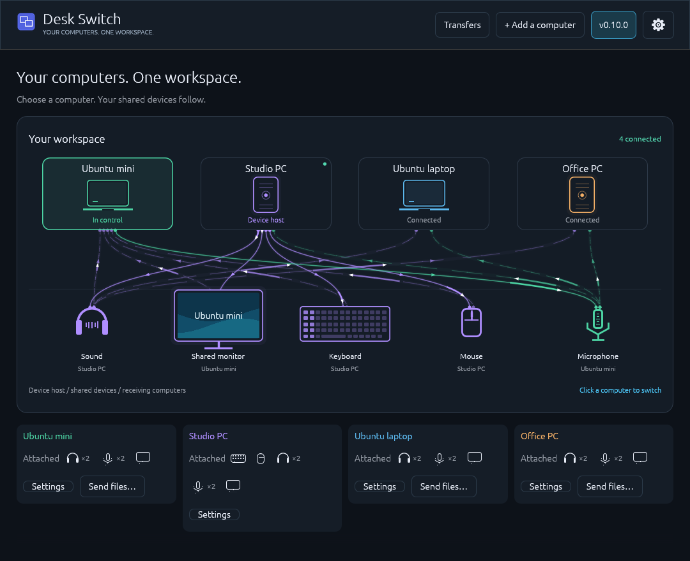
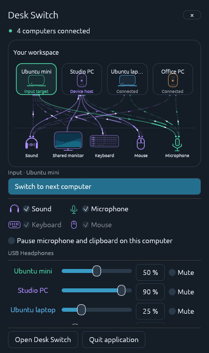
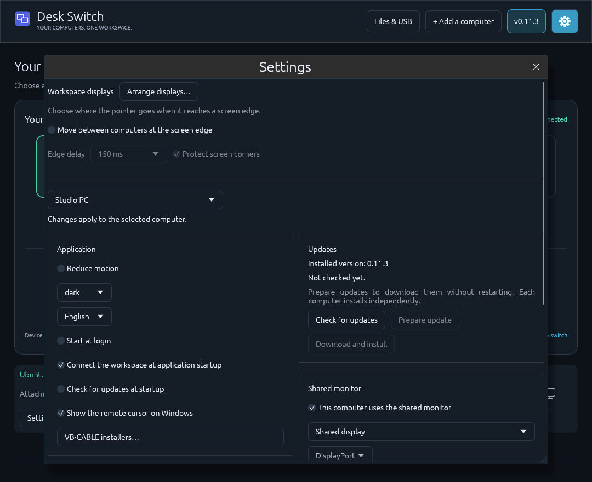

# Desk Switch

**Your computers. One workspace.** Share input, sound, microphones and clipboard across two, three, four or more computers. Manage every member from one place.

Download matching versions from [Releases](https://github.com/siarheisinelnikau/desk-switch/releases/latest) for **Windows x86-64** or **Ubuntu 24.04/26.04 x86-64**. Link computers with **+ Add a computer** and confirm matching codes on both ends. Click a computer in the workspace diagram to switch, **F12** to cycle, or **F11** to return input.

## What it does

- An animated workspace diagram: device hosts connect to shared devices, then onward to receiving computers.
- Keyboard/mouse sharing, arranged screen edges, crossing delay, protected corners and pause.
- All computers' sound on one output, with system and relative volume.
- One physical microphone delivered to virtual microphones.
- Shared text/images; file and folder copies or moves start when pasted, with progress, pause and cancel.
- Direct file sends with cancel and resume.
- Shared HDMI/DisplayPort monitor switching.
- Device choices, preferences and updates from any member.

A connected majority can replace an offline coordinator. Two computers need both online for shared changes. See the [setup, upgrades and limits](docs/guide.md).

## Quick controls

Left-click the tray icon for a compact workspace diagram, direct computer switching, sharing controls and per-computer volume. Right-click opens the native menu. **X** hides the window in the tray; **Quit application** exits.

Device animations stay active while visible and stop rendering when hidden. On Windows, the visible keyboard and mouse respond to local physical key presses, clicks, scrolling and movement direction. Input feedback is temporary and is never saved or sent over the network. Expand **Sharing & volume** in the main window for source choices and additional controls.

On Ubuntu GNOME, enable **Desk Switch Tray** in **Extensions**.

Settings

## Inspiration

A good friend shared this idea and showed me [Hotseat](https://github.com/muspelheim/hotseat), his project for switching monitor inputs on macOS. I built Desk Switch for my Ubuntu and Windows computers, extending the idea to keyboards, mice, speakers, headphones and microphones. Thank you, my friend, for the idea and inspiration.

The 0.10 release line ships Windows and Ubuntu installers only. macOS source remains experimental and has not been verified on physical hardware; no macOS build or update is published for this version. Earlier macOS releases remain available in the release history.
