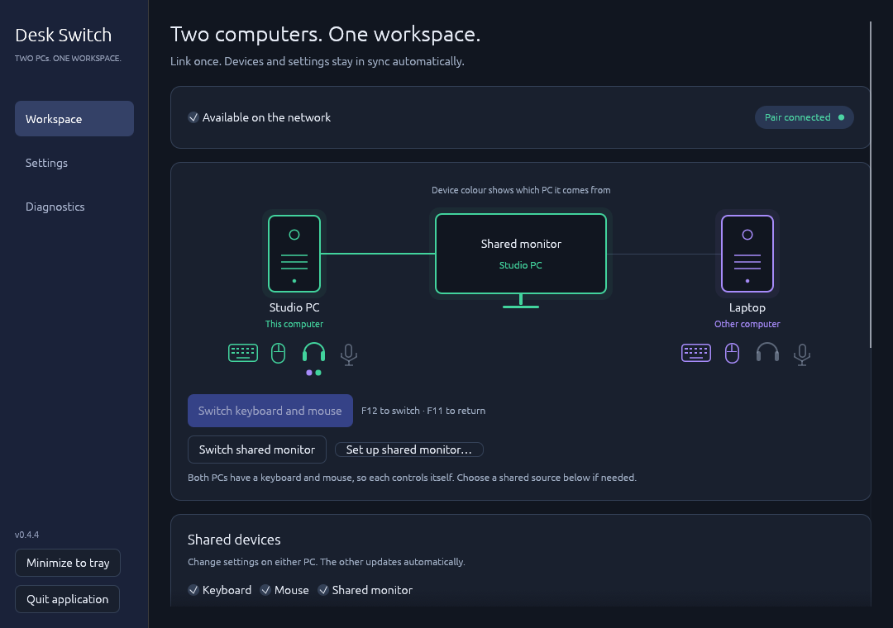
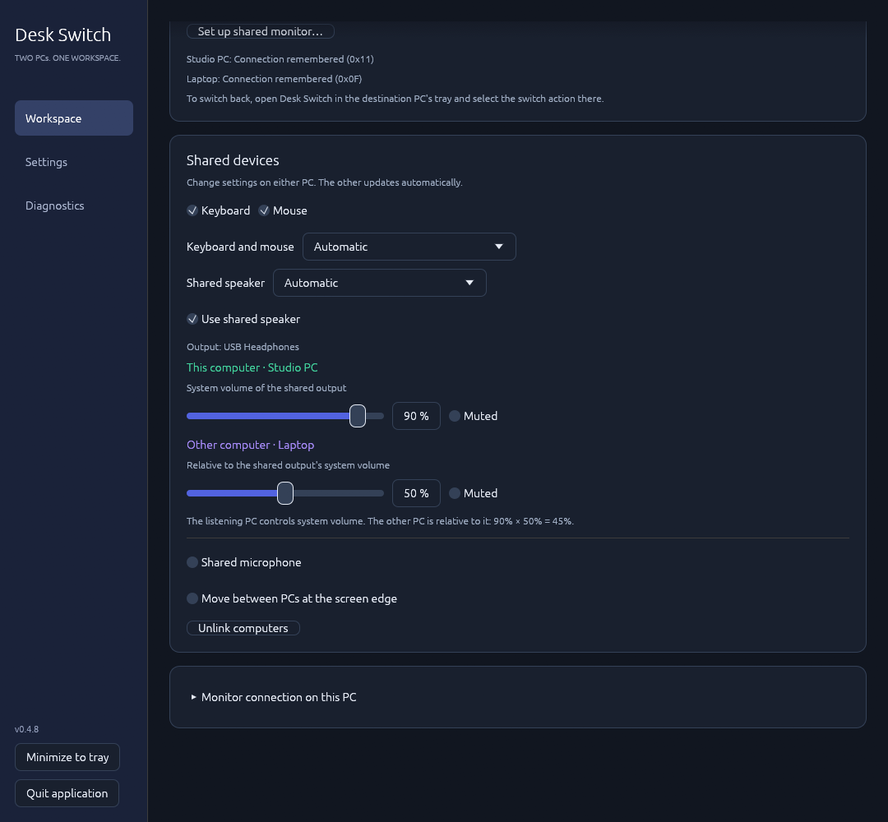
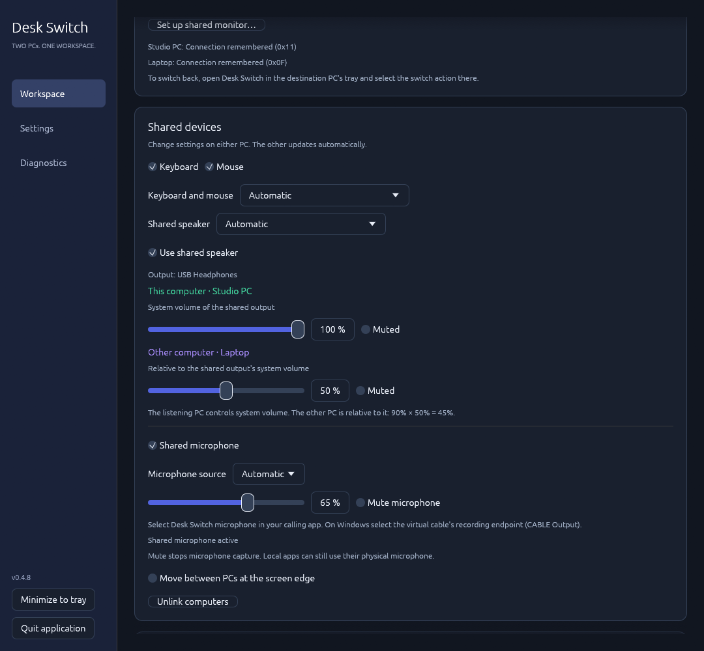
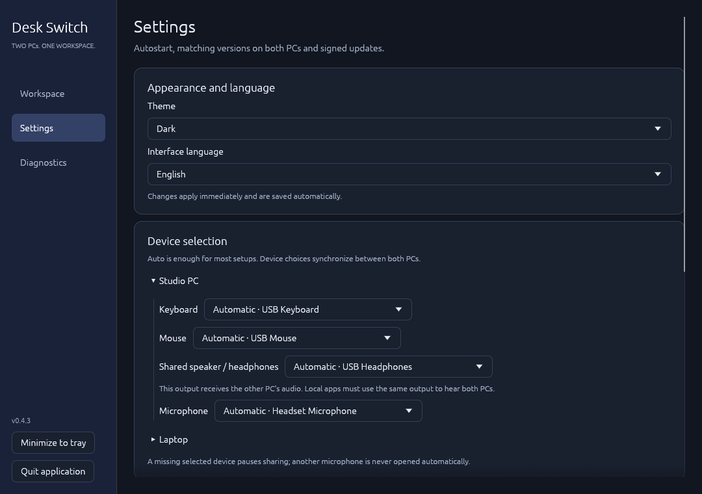
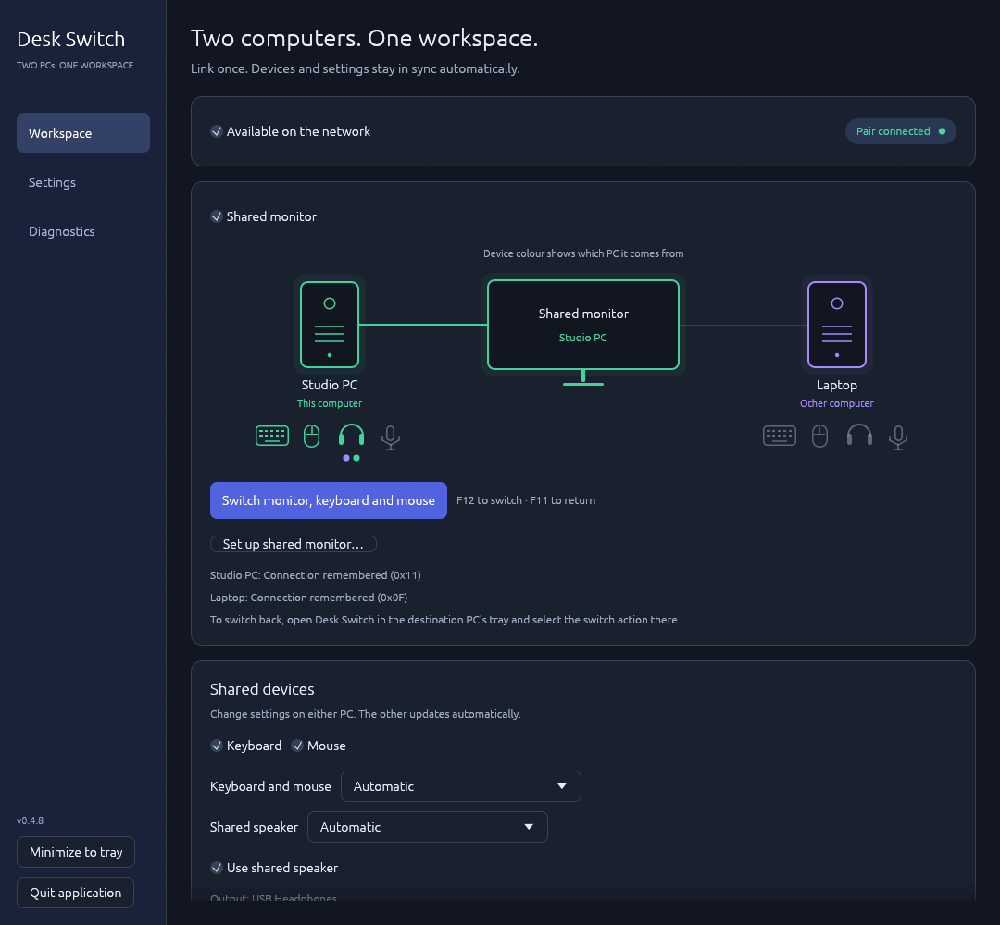
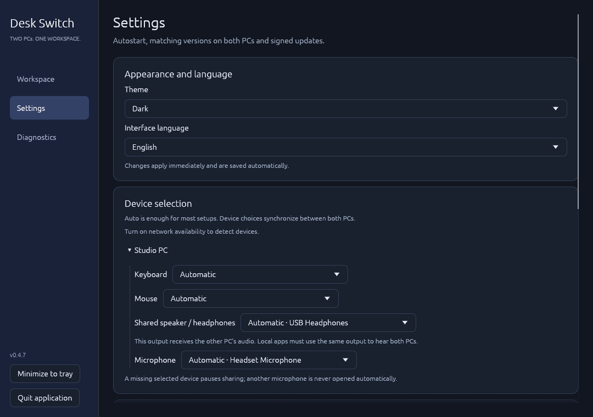
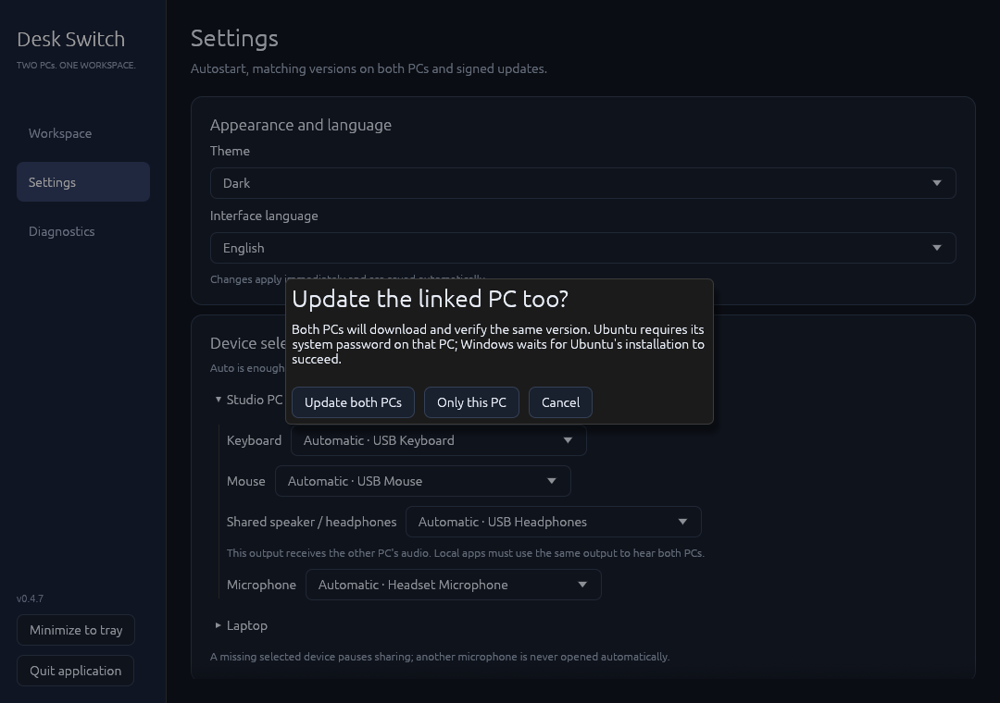

# Desk Switch

Two computers. One workspace. Share a keyboard, mouse, system audio and microphone between Windows and Ubuntu, with optional switching of a shared monitor's video input. Windows–Windows and Ubuntu–Ubuntu pairs use the same pairing flow.



## Install

Get the **same version on both PCs** from [Releases](https://github.com/siarheisinelnikau/desk-switch/releases/latest). New releases contain exactly two downloads:

- **Ubuntu 24.04/26.04 x86-64:** `desk-switch-linux-x86_64.deb`.
- **Windows x86-64:** `desk-switch-v0.4.8.exe`.

```sh
sudo apt install ./desk-switch-linux-x86_64.deb
```

Open **Desk Switch** from Ubuntu's application menu or run the Windows executable. New profiles use **English** and **Dark**. Existing language/theme choices are preserved. Russian, German, French, Spanish and Italian are also available. Language and theme changes apply immediately to the window and tray.

## Link your PCs

1. Turn on **Available on the network** on both PCs. Each advertises itself and discovers other computers at the same time. Different application/protocol versions remain visible with an update hint.
2. Click **Link** beside the other PC. On that PC, click **Accept**. The application creates and exchanges keys automatically. Both screens show the same optional confirmation code: no tokens, IP addresses or manual key copying.
3. Once settings are synchronized, one PC is purple and the other green. Both screens agree on those identities. **This computer is always on the left** of its own window. Everything stays grey before synchronization and after a lost connection.

For a routed network or when multicast is unavailable, open **Connect by IP address** and enter the other PC's IP (optionally `IP:port`, or `[IPv6]:port`). Link and Accept work the same way; an existing pinned identity cannot be replaced by changing an address. A route or VPN and firewall access are required across subnets. The default TCP ports are **45878** for pairing/settings, **45876** for input, **45877** for system audio and **45879** for the microphone. This does not provide NAT traversal.

Approval is required before either key is pinned. Existing peers reconnect without another prompt. **Unlink computers** removes a live pair on both PCs; an offline peer can also be unlinked locally. Disabling availability stops discovery, the control connection and shared devices. Allow Desk Switch on your private LAN if the operating system requests firewall permission.

## Devices follow the pair

- **Keyboard and mouse:** the PC with both physical devices supplies input. With devices on both PCs, each controls itself by default; choose a shared source if wanted. Devices are checked every three seconds, so temporarily connecting input for setup does not require changing roles manually. Detected devices light up even while the sharing service is starting or needs system access. Automatic capture supports relative mice, including composite gaming receivers with auxiliary volume axes, and keyboards with F11/F12; touchpads are not host pointers.
- **Shared speaker:** choose the PC with the shared speakers or headphones. Both PCs' sound plays together there. The listening PC's slider controls the selected output's actual **system volume and mute**. The other PC's slider sets its forwarded audio to **0–100% relative to that output**. Either PC can adjust both controls. Automatic speaker selection prefers a default headphone/Bluetooth output, then speakers, then HDMI/DisplayPort. Disable **Use shared speaker** to stop forwarding; system volume keeps its current value. Audio stays independent of input switching and never forwards a remote mix back to its source. No virtual audio driver is required.
- **Switching:** click **Switch keyboard and mouse** or press **F12**. **F11** returns input to the physical keyboard PC. Optionally enable screen-edge crossing and select this PC's left or right edge. The return edge is configured automatically; the diagram keeps this computer on the left.
- **Colours:** a device retains its source PC's colour on the other PC. A lent keyboard/mouse becomes grey at the source after handoff is confirmed. Headphone colours identify the PC with the shared speaker; two coloured dots indicate a connected, unmuted remote audio stream. For a shared display, PC towers appear at the sides and one monitor in the middle. The monitor takes the colour of its confirmed active video input and stays grey while the input is unknown.

Shared choices made on either PC propagate automatically. Device inventories and selections are synchronized; monitor calibration stays local. Device errors provide a retry action and details under **Diagnostics**.

Keyboard, mouse, shared speaker and shared monitor can each be enabled separately. Unshared input stays local. The receiving PC must retain a keyboard and mouse, either its own devices or the shared ones: a handoff that would leave it without input is blocked. While its only input is being shared, the corresponding disable controls are locked on both PCs; return input first with F11. Changing an allowed input option releases held keys before reconfiguring the service.

The listening PC's level is the output's existing system volume, including changes made with media keys or OS controls. Desk Switch reads it on startup instead of replacing it with a saved value. Remote audio receives one relative gain before playback: with a 90% system level and 50% remote level, the conceptual result is 45%. System sliders can use a nonlinear acoustic curve, so this is a volume relationship rather than a calibrated loudness measurement. Changing the remote level never changes local applications or the output's master volume. System mute silences both PCs; remote mute silences only forwarded audio. Closing Desk Switch, reconnecting or moving the headphones does not restore or copy a system level onto another output. Any per-application gain journal left by older releases is recovered separately. Standard shared desktop audio is supported; exclusive or encoded passthrough streams are outside this mixer.

Audio uses 48 kHz stereo PCM. Windows capture follows actual device samples rather than a polling timer; partial packets are joined without padding each short packet with silence. Playback starts with a 40 ms jitter buffer and can rebuffer up to 80 ms after an underrun. Short network stalls discard expired packets and renew flow-control credits on the same connection, instead of restarting capture and playback. Device and network scheduling still determine the total end-to-end latency.



## Choose devices

**Settings → Device selection** keeps Auto as the default and lists each PC's devices. Either PC can choose the other PC's output or microphone. A missing explicit selection pauses the corresponding service instead of falling back. Linux keyboards and relative mice can be selected separately, including composite HID interfaces; Windows shares its keyboard/mouse group because the current hooks cannot reliably suppress one individual physical device. Return input before changing its source or bindings.

An explicit speaker/headphone output receives the other PC's sound there. Local applications retain their OS routing: select the same output in the OS/apps to hear both PCs. The system-volume control follows that selected output, including when it differs from the OS default.

## Shared microphone

**Shared microphone** is off by default. Enable it, leave the source on Auto or choose its PC, then select **Desk Switch microphone** in the receiving calling/recording application. Forwarded gain and **Mute microphone** synchronize from either PC; mute stops capture. Local applications on the source can still use the physical microphone normally.

Auto binds to one physical endpoint when sharing starts. Changing the OS default or unplugging that microphone never opens a different microphone automatically. Choose a replacement in Settings or disable/re-enable sharing to resolve Auto again. The microphone has its own authenticated transport and remains independent of the shared speaker, input and monitor. It is never played to ordinary speakers or selected again as a capture source.

- **Ubuntu receiver:** PipeWire creates a temporary virtual source. It disappears when sharing stops; Desk Switch does not set the OS default input.
- **Windows receiver:** install [VB-CABLE](https://vb-audio.com/Cable/) if needed. Desk Switch renders only to a detected cable playback endpoint; choose its paired **CABLE Output** recording endpoint in the calling app. Keep your regular headphones/speakers as the Windows playback output; select CABLE Output only as the calling app's microphone. The cable is excluded from shared-speaker selection. The application provides the setup link and does not silently install or redistribute the driver. Sending a physical Windows microphone to Ubuntu does not require this driver on Windows.





## Optional shared monitor

Connect the physical monitor to both PCs, using different HDMI/DisplayPort inputs. Select the synchronized **Shared monitor** checkbox. On **each** PC, expand **Monitor connection on this PC**, choose the local display, and remember the connection while viewing that PC's picture. Each PC reports its own setup status and shares its saved input with its partner. There is no manual entry of the other PC's input code. Read-only status checks keep the central monitor's colour current without changing its input.

The **Shared monitor** checkbox declares that both saved connections belong to one physical monitor. DDC/CI switching uses each PC’s own selected display and remembered input; different HDMI/DisplayPort EDID fingerprints do not block it. The two saved input codes must be distinct. The destination PC first selects its own remembered input and confirms it before input devices are forwarded. If DDC/CI is inaccessible through the inactive port, the currently active PC tries the same saved input as a fallback. Returning uses the same destination-first order. Monitor-only switching is bidirectional and works independently of keyboard ownership, including after a restart on either input. Reading a connection never switches the display. With **Shared monitor** selected, incomplete calibration blocks a new input handoff instead of silently leaving the picture behind; an already borrowed keyboard/mouse can still be returned. Enable DDC/CI in the monitor's menu if its connection cannot be read. Re-read the local connection after moving a cable. Other displays are not switched.

For first-time setup with only one keyboard/mouse, **Switch keyboard and mouse only for setup** explicitly lends input without changing video. Select the other PC's input in the monitor menu and remember its connection there. The read-only result is held locally until input is returned with F11; use the monitor menu to return the picture during this first setup. Normal F12/edge switching waits for video calibration and never silently downgrades to input-only sharing.



DDC/CI depends on the monitor and firmware. The previously tested LG setup reported “out of range” and is not considered validated. There is no automatic scan through possible video inputs or display mode changes.

## Window, tray and startup

**X** and **Quit application** stop services and exit. **Minimize to tray** is separate. Quit first requests cooperative input release and audio shutdown; an unresponsive child is terminated after six seconds. Closing the GUI command pipe also requests shutdown. Losing the tray brings a hidden window back.

Autostart is enabled after the first launch and can be disabled in **Settings**. It starts in the tray using the saved profile and availability choice. Ubuntu needs an AppIndicator/StatusNotifier host for a visible tray icon.



## Updates

Installed Debian packages and the Windows executable use [`rust-auto-updator` 0.4.1](https://github.com/siarheisinelnikau/rust-auto-updator). The original core is included under `vendor/` with its licence and source hashes. The host additionally verifies a pinned Ed25519 signature covering each installer's exact URL, version, size and SHA-256. Signed metadata lives in the release description, keeping the download list limited to `.deb` and `.exe`.

Checks/downloads run at startup and every six hours. Click **Update and restart** to install. When linked, choose **Update both PCs** or **Only this PC**. Each PC independently downloads and verifies the same signed version before installation starts; no executable or download URL is accepted from the partner. Ubuntu still requires its local system password. In a Windows–Ubuntu pair, Windows waits for the Ubuntu package installation to succeed. Cancelling Ubuntu authorization leaves Windows on its current version. The app, paired connection and existing devices stay available during the password dialog. Settings and pairing survive updates. Input and audio remain blocked between different app/protocol versions; installation or network failures on one PC can require retrying its update.



Recent service logs are synchronized over the authenticated, encrypted paired connection. **Diagnostics → Copy diagnostics** includes both PCs' state and recent logs, so they do not need to be collected separately. The last received peer report remains available in the open app after a disconnect and is labelled offline. Log snapshots are bounded and do not reconfigure device services.

For the first upgrade from **0.3.x or older**, install the new `.deb` / replace the `.exe` once: older versions expect a separate metadata download. Subsequent updates use the two-file release format. Portable Linux binaries are no longer distributed. The `.deb` runs `/usr/lib/desk-switch/desk-switch` through its installed launcher so package ownership and future system updates work correctly.

## Platform access

Ubuntu uses the desktop RemoteDesktop/EIS portal. Approve the system dialog when it appears. A Linux keyboard host also needs read access to the selected `/dev/input/event*` devices. If access is denied, Desk Switch automatically requests administrator approval once for the selected devices. Approve the Ubuntu system dialog; **Allow keyboard and mouse access** remains available for a manual retry. Cancelling does not trigger repeated prompts on reconnect. The package's narrow polkit helper validates physical keyboard/relative-mouse interfaces and grants only that desktop user read access to the selected device nodes; it cannot authorize arbitrary files. No input-group membership is needed. The approved physical identities are saved in an administrator-owned policy for that desktop account. The package restores their read access after USB reconnection, port changes and restart, without another authentication prompt. A device serial/unique ID is used when available; devices without one are matched by bus, hardware IDs, name and keyboard/mouse interface. Other device models and other users are not authorized. Use **Settings → Keyboard and mouse permissions → Remember keyboard and mouse access** to save an existing temporary grant. The input service retries without recreating the pair. Brief settings-channel disconnects keep the existing input session; Wayland restore tokens are stored privately and rotated after each successful start when the desktop supports persistent consent. The GUI runs as your desktop user; only the narrow access helper is elevated. Pairing alone never grants OS permissions. PipeWire/WirePlumber provide audio. The Debian package requires `ddcutil`, `pipewire-bin`, `pipewire-pulse`, `pulseaudio-utils`, `acl` and `python3`, so APT installs the monitor/audio tools automatically. System volume uses the selected PulseAudio-compatible PipeWire sink; per-channel balance is preserved. Monitor switching needs I²C access and remembered input mappings. The synchronized **Shared monitor** checkbox alone selects the diagram: checked shows two PC towers and one central monitor, unchecked shows two separate monitors. New profiles leave it unchecked. Saved choices are preserved. DDC/CI setup does not select the layout; its colour remains unknown until the video input is confirmed. Use **Set up shared monitor…** in either tray, then remember the current connection on each PC while its own picture is visible. **Switch shared monitor** is available independently of keyboard forwarding when both PCs have their own input devices. When input is shared, switching moves the monitor and input together; switch back from the destination PC’s tray. No unconfigured video input is tried. The package recommends the desktop portal and WirePlumber.

Windows uses native hooks, SendInput and WASAPI loopback/shared playback. System volume uses Core Audio endpoint volume for the selected output. If the receiving Windows PC has no physical mouse and its system cursor is hidden, Desk Switch draws a temporary click-through pointer while mouse input is shared. It follows the system cursor position and shape, disappears when native cursor drawing or a physical mouse returns, and changes no global mouse settings. DDC/CI uses Windows' built-in monitor API (`GetVCPFeatureAndVCPFeatureReply` / `SetVCPFeature` in `Dxva2.dll`), so no separate monitor utility is required. Input cannot control a higher-privilege application without matching system permission. Headphone/Bluetooth detection is a default-output heuristic; explicitly selecting the shared speaker PC overrides it everywhere.

## Development and release

Requires Rust 1.99+, OpenSSL/X11/Wayland development libraries on Linux, and `dpkg-dev` / `desktop-file-utils` for packaging.

```sh
cargo fmt --all --check
cargo clippy --locked --all-targets -- -D warnings
cargo test --locked
python3 tools/test_input_access.py
cargo build --locked --release
python3 tools/package_deb.py --binary target/release/desk-switch --out dist
python3 tools/verify_deb.py dist/desk-switch-linux-x86_64.deb
```

Tests use synthetic input/audio/monitor devices and loopback peer connections. They cover approval/rejection, automatic key exchange, manual IP connections, pin protection, reconnection from either side, simultaneous requests, paused-GUI event delivery, shared decisions, capability changes, monitor mappings, version rejection, signed metadata and input release. GUI screenshots use isolated fixture PCs and never switch a real monitor or grab input. Windows captures use a bounded native render-and-exit process; Linux captures use a private Xvfb display and private D-Bus. The portal regression test (`/usr/bin/python3 tools/test_portal_restore.py --binary target/debug/desk-switch`, requiring `python3-gi` and `dbus`) creates its own D-Bus and fake portal to verify persistent consent, token rotation and cancellation without touching the compositor. Native CI builds/tests on Ubuntu and Windows. `dbus-run-session -- python3 tools/test_microphone_pipewire.py` (PipeWire and WirePlumber 0.5+) validates microphone PCM forwarding, live gain and virtual-input/capture cleanup on a separate server using a synthetic tone, with hardware monitoring disabled. Real two-PC multicast, interactive Windows, VB-CABLE and monitor firmware still need target-machine validation. Use **Diagnostics → Copy diagnostics** to capture both PC states and recent service messages without private keys. The explicit CLI remains available through `--help`.

For optimized native UI QA, build with `cargo build --locked --profile diagnostic --features eframe/__screenshot`. Set `EFRAME_SCREENSHOT_TO` to an absolute PNG path and run `target/diagnostic/desk-switch gui-preview shared-audio --state-dir ABSOLUTE_ISOLATED_DIRECTORY`; the capture exits after layout settles. Without that variable, `DESK_SWITCH_RENDER_PROBE=ABSOLUTE_JSON_PATH` runs a bounded visible/hidden/restored fixture check and exits. The probe reports UI frame counts and the actual renderer; it does not certify real device services or GPU presentation timings.

Set `release/publish-request.json` to the new version tag to build and test both installers. If the `DESK_SWITCH_UPDATE_SIGNING_KEY` Actions secret contains the existing pinned Ed25519 private key (PEM or base64-encoded PEM), CI verifies that key, signs the tested installers, then promotes the release automatically. A missing secret leaves a prerelease candidate outside the stable update channel. The private key is never uploaded as an artifact or committed.

For local signing instead, download the two tested installers, then run:

```sh
python3 tools/prepare_release.py --tag vVERSION --windows PATH.exe --deb PATH.deb --out dist/signed
```

Commit the metadata as `release/manifests/VERSION.json`. Promotion verifies the signature, public downloads, package metadata and both embedded build stamps before publishing stable. The signing key stays in the ignored `.release-private/` directory and is never sent to GitHub. Back it up. Existing tags and signed releases must not be reused.
