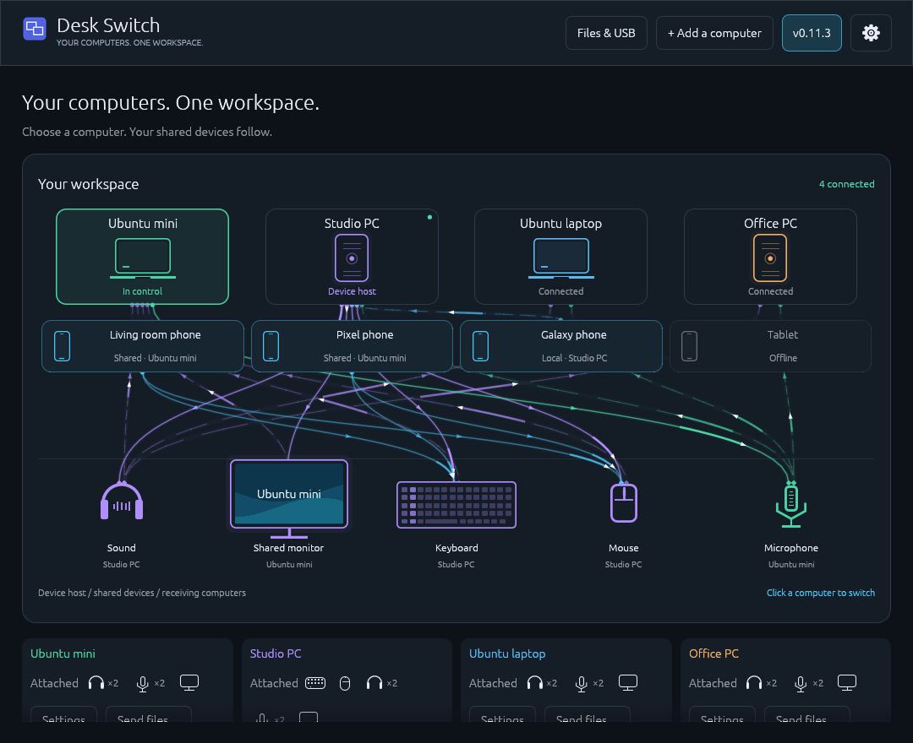
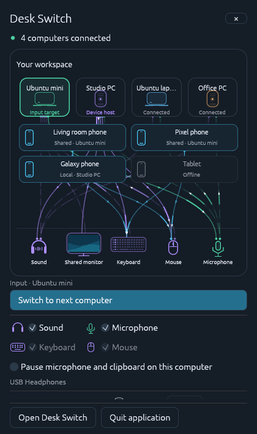
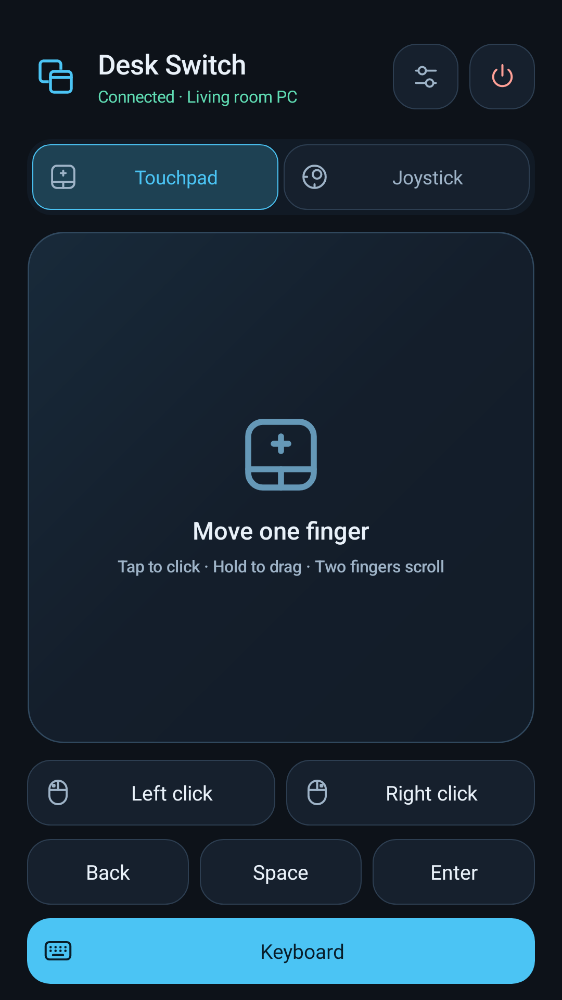
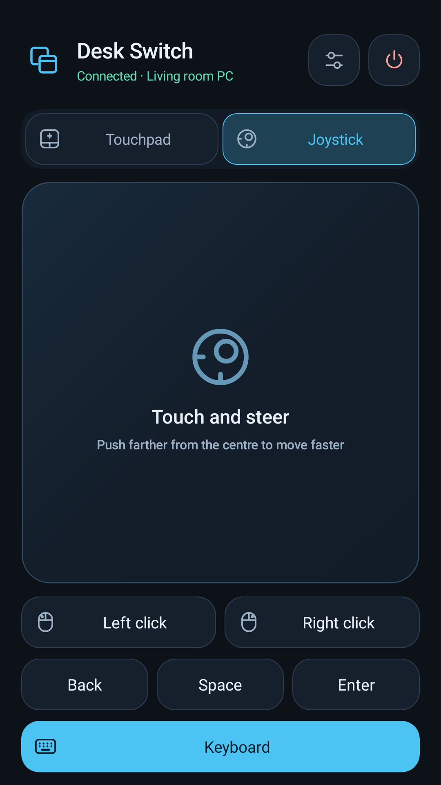
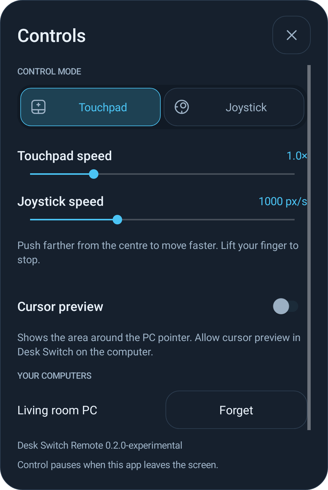
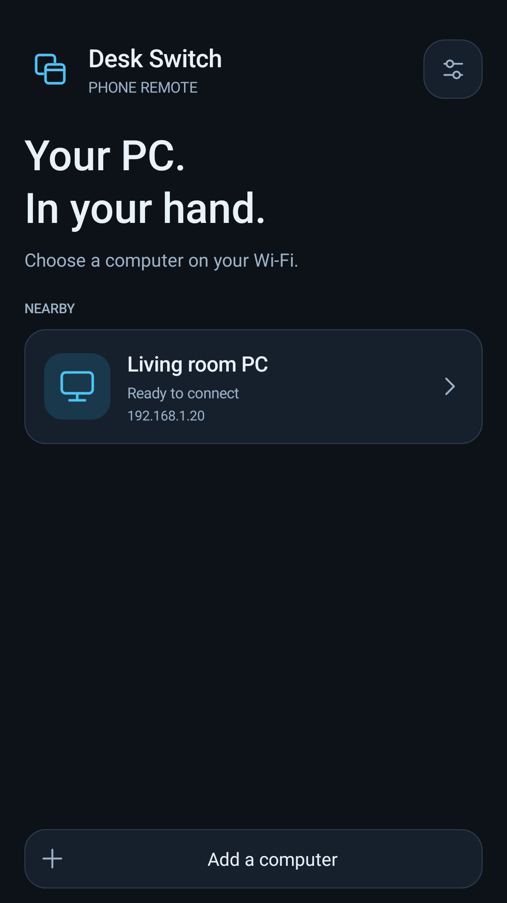
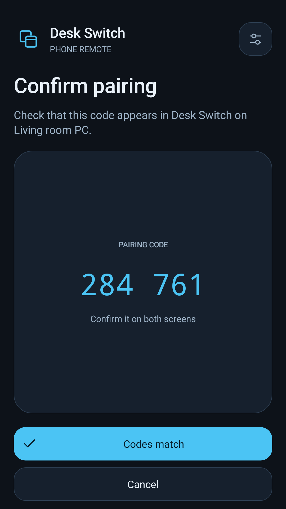
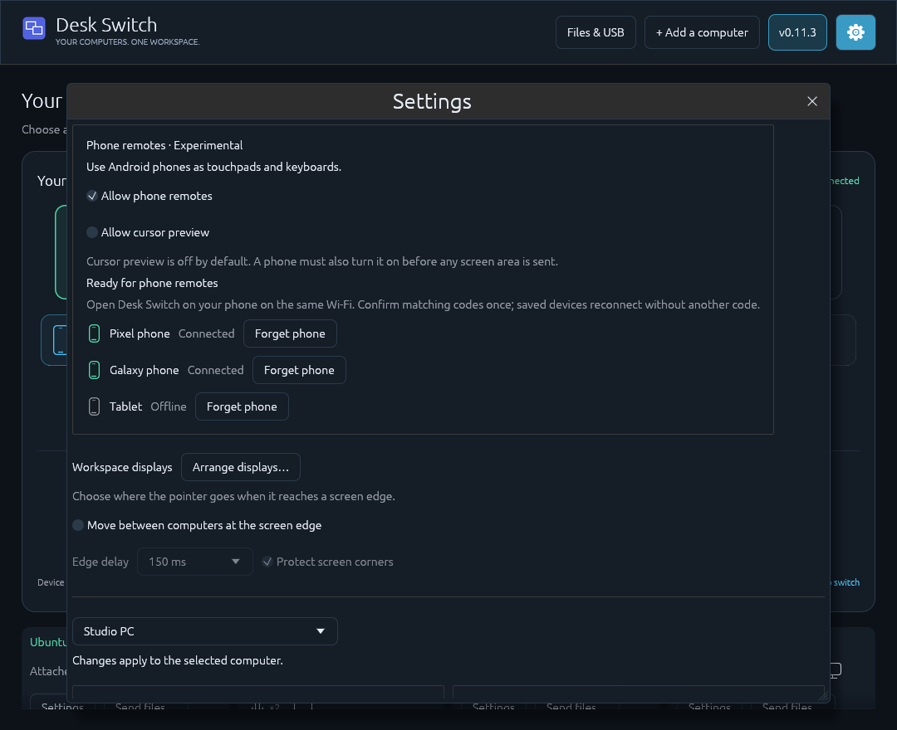

# Desk Switch phone remote

Use an Android phone as a keyboard and pointing device for your Desk Switch workspace. Several phones can be paired at once. Check **Shared** beside a phone in **Sharing & volume** to let it follow the selected computer. Uncheck it to use that phone with its paired computer only.



<details>
<summary>Phone routes in the tray popup</summary>



</details>

1. Open the experimental build of Desk Switch on the computer and the Android app on the phone. Join the same local network on both devices.
2. Select the computer on the phone and confirm the matching code on both screens. Desk Switch remembers approved computers and phones.
3. Use the **Touchpad** or **Joystick** and tap **Keyboard** to type in the computer's focused app. **Controls** saves the speed of each mode separately. Use the power icon in the top bar to disconnect.

<p>
  
  
  
</p>

<details>
<summary>Finding and pairing a computer</summary>

<p>
  
  
</p>
</details>

Enable **Allow cursor preview** on the paired computer and on each computer you want to preview. Enable **Cursor preview** in the phone's **Controls**. The area around the cursor fills the pointing surface, which still accepts gestures. Set a rate from 1 to 30 FPS. The preview pauses during a workspace switch and stops when the phone leaves the app or either setting is turned off. Frames are encrypted in transit and held only in memory.



The Android app requires Android 8 or later. Install the experimental desktop build on each computer that should receive shared phone input. Ubuntu input uses the Wayland remote desktop permission, and typed text pastes through the target computer's clipboard. Cursor preview on GNOME Wayland uses the companion bundled with the Ubuntu package. If automatic discovery is unavailable, enter the computer's local IP address in the Android app.

## Build and verify

Use the repository's Rust toolchain, JDK 23, Android SDK Platform 35, and Android Build Tools 35.0.0. The branch's [GitHub Actions runs](https://github.com/siarheisinelnikau/desk-switch/actions/workflows/checks.yml?query=branch%3Aexperiment%2Fandroid-remote) publish experimental APK, Windows, and Ubuntu build artifacts.

```sh
cargo build --locked --release --features android-remote
cd android
./gradlew :core:test :app:testDebugUnitTest :app:lintDebug :app:assembleDebug --max-workers=2
cd ..
python tools/test_android_remote.py
```

On Windows use `gradlew.bat`. The APK is at `android/app/build/outputs/apk/debug/app-debug.apk`. The interoperability check runs the actual Android transport against an isolated desktop input sink. It exercises pairing, touchpad input, Unicode text and release on disconnect.

The desktop build uses the existing profile and Wi-Fi announcement. For a temporary Windows test, `DeskSwitch-v0.11.3-android-experiment.exe gui --experimental-mobile` opens the ordinary interface and preserves the previous login startup command. The desktop device and workspace protocols remain 9 and 3. Cursor preview negotiates optional records in the encrypted control stream.
