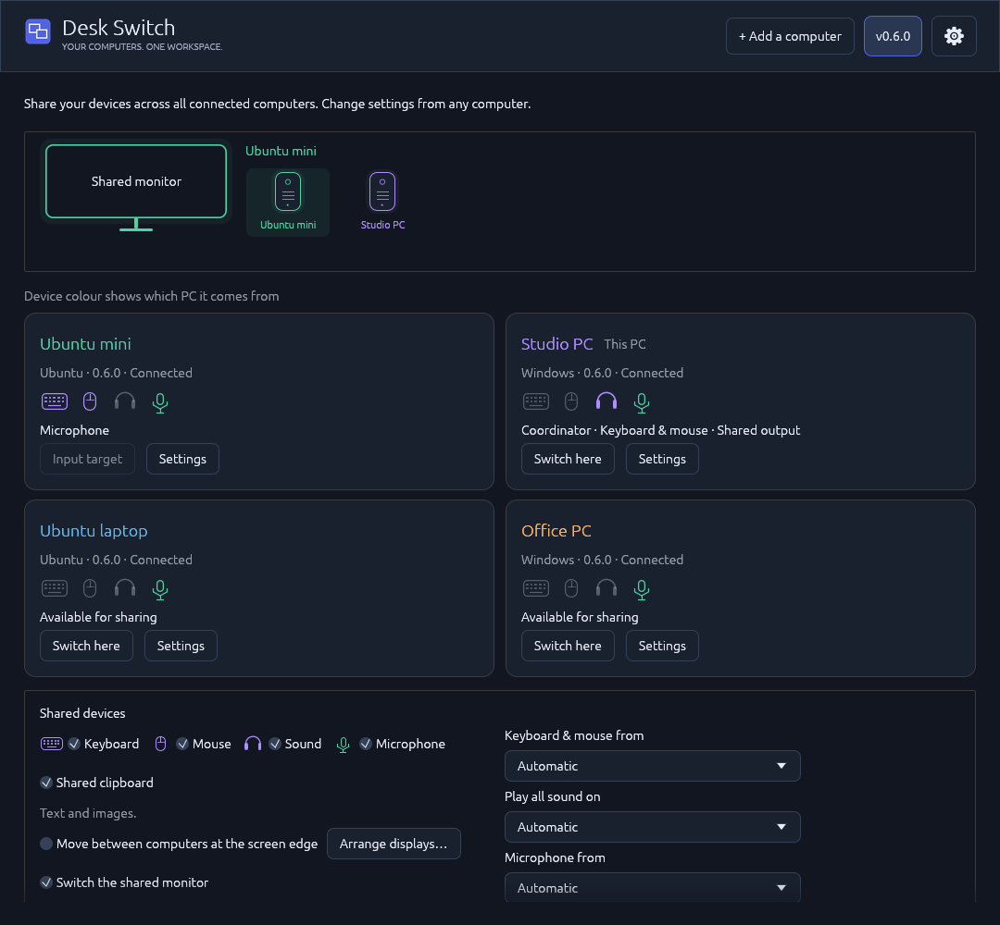
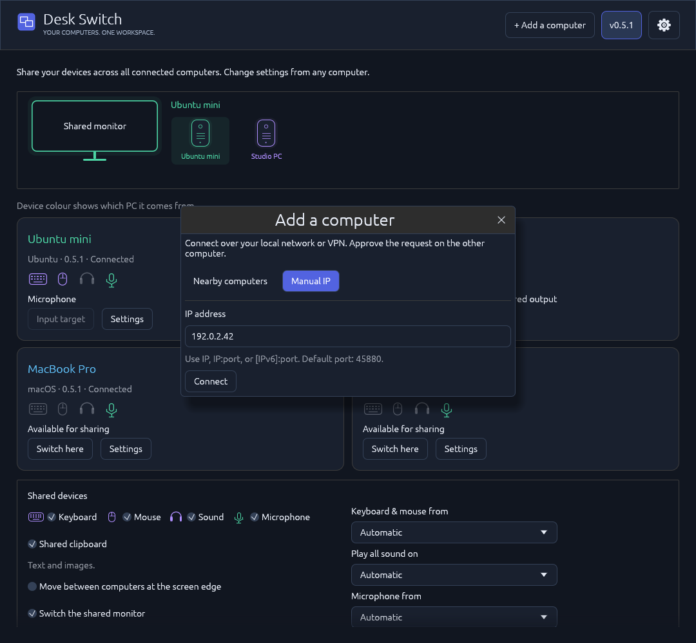
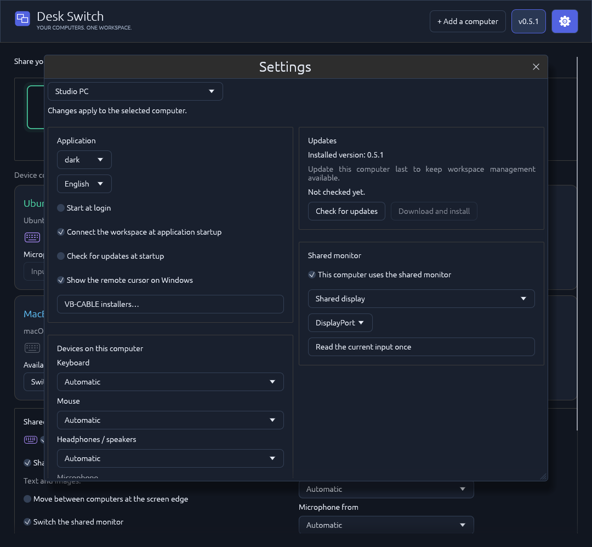
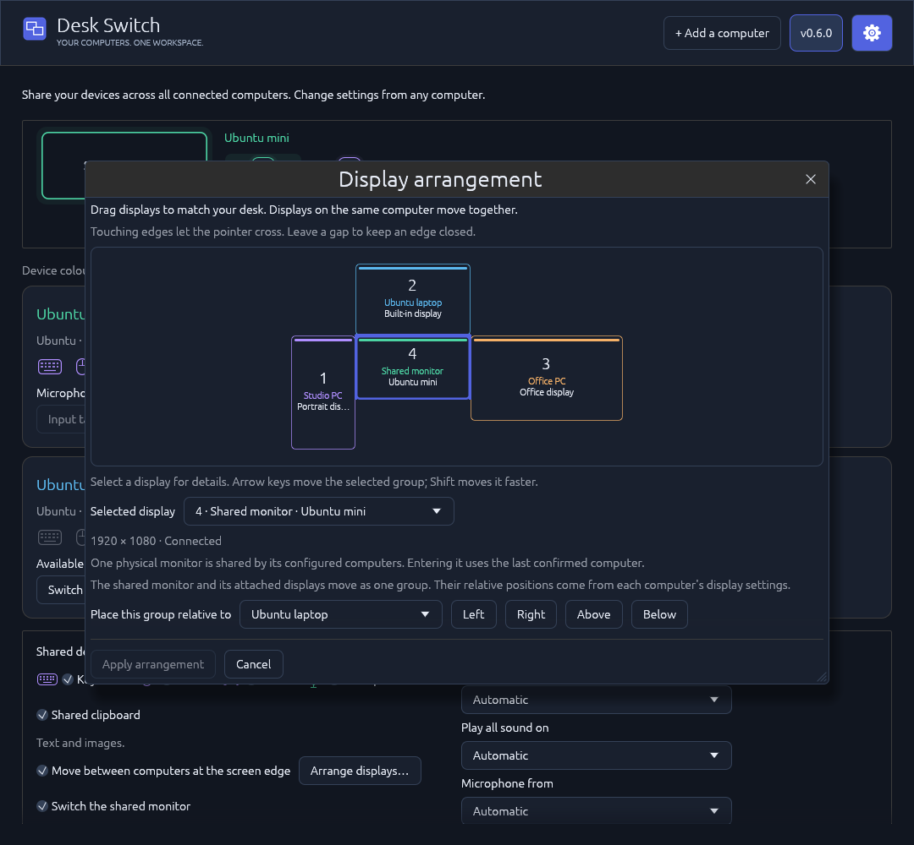
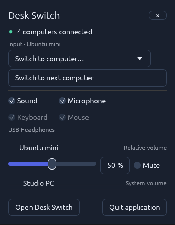

# Desk Switch guide

Your computers. One workspace. Share a keyboard, mouse, headphones or speakers, microphone and an optional clipboard across **two, three, four or more computers**. Control the workspace and each computer's settings from any member, send files directly, and arrange screens around your desk. Releases support Windows, Ubuntu and experimental Apple Silicon/Intel macOS bundles. A shared monitor can follow the selected computer through DDC/CI.



## Install

Install the **same version on every computer** from [Releases](https://github.com/siarheisinelnikau/desk-switch/releases). Version **0.8.0** has four native downloads:

| Platform | Download |
| --- | --- |
| Ubuntu 24.04/26.04, x86-64 | [desk-switch-v0.8.0-linux-x86-64.deb](https://github.com/siarheisinelnikau/desk-switch/releases/download/v0.8.0/desk-switch-v0.8.0-linux-x86-64.deb) |
| Windows, x86-64 | [desk-switch-v0.8.0-windows-x86-64.exe](https://github.com/siarheisinelnikau/desk-switch/releases/download/v0.8.0/desk-switch-v0.8.0-windows-x86-64.exe) |
| macOS 13+, Apple Silicon (experimental) | [desk-switch-v0.8.0-macos-arm64.zip](https://github.com/siarheisinelnikau/desk-switch/releases/download/v0.8.0/desk-switch-v0.8.0-macos-arm64.zip) |
| macOS 13+, Intel x86-64 (experimental) | [desk-switch-v0.8.0-macos-x86-64.zip](https://github.com/siarheisinelnikau/desk-switch/releases/download/v0.8.0/desk-switch-v0.8.0-macos-x86-64.zip) |

```sh
sudo apt install ./desk-switch-v0.8.0-linux-x86-64.deb
```

Open **Desk Switch** from Ubuntu's application menu or run the Windows executable. New profiles use **English** and **Dark**. Existing language and theme choices are preserved. Russian, German, French, Spanish and Italian are also available; changes apply immediately to the window and tray.

## macOS (experimental)

**Version 0.6.2 restores experimental Apple Silicon and Intel macOS app bundles and their signed in-app update targets.** Versions 0.6.0 and 0.6.1 remain Windows/Ubuntu-only. Both Mac architectures must pass native compile, test and package checks before publication. **macOS functionality has not been tested on physical hardware.** Those checks do not verify real input devices, audio routing, permissions, monitor firmware or UI performance on a Mac. macOS 13 or newer is required.

Unzip the archive for your Mac's architecture and move the complete **Desk Switch.app** to **Applications** or **~/Applications** before opening it. The bundles and their embedded native helpers are ad-hoc signed, but are **not Developer ID signed or notarized**. Follow macOS's normal Open/Privacy & Security flow if Gatekeeper blocks the first launch. In-app updates verify the project's pinned Ed25519 signature and replace the complete application bundle, preserve the separate settings directory, and retain a rollback copy until the new GUI confirms startup. **~/Applications** supports updates without administrator credentials; a read-only or protected installation directory produces a clear error instead of requesting elevation.

The Mac adapter uses native OS APIs:

- **Input:** CoreGraphics capture and injection, physical key mapping, normalized screen-edge handoff, F12 switching and F11 emergency return. The recipient uses its system cursor, with no painted cursor overlay. Accessibility is required; capture and the recipient's local emergency-key listener may also need Input Monitoring. On keyboards that use function keys for media/system actions, press Fn with F11/F12 or enable standard function keys in macOS settings. Mac keyboards and pointers are shared as one group; selecting one individual physical Mac input device is not supported.
- **System audio:** ScreenCaptureKit records audio only; no video frames are registered, sent or saved. macOS still requires Screen Recording/System Audio Recording permission. Capture follows the **default system output mix**; a selected nondefault capture output is rejected. Desk Switch playback workers are excluded from the application filter to avoid forwarding received audio or the virtual microphone feed. Newly launched applications join that filter within approximately two seconds. CoreAudio plays received audio on the selected output and reads/writes that output's real system volume. HDMI/DisplayPort and other fixed-level outputs may have no writable macOS volume/mute control; an attempted change reports that limitation. Received streams still have independent relative volume and mute. Public macOS APIs do not provide the Windows/Linux per-application gain-recovery mixer.
- **Microphone:** AVAudioEngine captures the selected physical microphone after macOS grants Microphone access. To receive a shared microphone, install **VB-CABLE** or **BlackHole**, select its virtual playback endpoint in Desk Switch and choose the matching virtual recording input in your calling app. The saved official VB-CABLE installer can be extracted or opened from the app; macOS's Installer completes driver installation. Desk Switch never routes a received microphone to ordinary speakers.
- **Monitor:** explicit reads and one VCP `0x60` input-selection transaction on a supported external DDC/CI connection. Intel uses IOI2C; Apple Silicon includes the MIT-licensed [m1ddc transport](../vendor/m1ddc/README.md), which uses private macOS APIs. The built-in display cannot switch video inputs, and some USB-C/Thunderbolt adapters, GPUs and monitors expose no supported transport. Unsupported access produces an error; the application never probes alternate input codes or repeats a selection automatically.
- **Desktop integration:** a menu-bar icon provides the shared quick-controls popup on left click and the native menu on right click. Closing the window keeps the app in the menu bar. Optional login startup uses the current user's LaunchAgent. Clipboard sharing uses the system pasteboard when enabled for the group. Native file paste into Finder is unavailable; explicit file transfers still work.

Permissions are granted through macOS itself and cannot be bypassed. On macOS 15 or newer, allow **Local Network** access for discovery and connections; it can be changed in **System Settings → Privacy & Security → Local Network**. See [Apple's local network privacy guidance](https://developer.apple.com/documentation/technotes/tn3179-understanding-local-network-privacy). File transfers may also need normal **Files and Folders** access for protected folders or drives. A denied permission fails that operation. macOS may request consent again after an update; stable permission retention with ad-hoc signed builds has not been verified. Settings and identities live in **~/Library/Application Support/desk-switch** unless a custom profile directory is supplied. A real Mac screenshot and settled/hidden performance measurements are still needed; the README screenshots below were generated by the Windows application.

## Link your computers

1. Start Desk Switch on the computers you want to link. The workspace advertises itself on the local network while the application is running.
2. Click **+ Add a computer** in the header. In **Nearby computers**, choose a discovered computer and click **Connect**. Approve the connection with **Allow** on the invited computer. Compare the displayed security code when confirming a new identity; keys are created and exchanged automatically. The dialog shows the pending approval, completion or a connection error.
3. Repeat for each additional computer. Every member sees the complete workspace, connection status and device roles. Use **Switch here** on a computer's card to select it, or **Settings** to manage it.

One trusted computer coordinates workspace changes. If it disconnects, sleeps or restarts, the remaining members can elect another coordinator automatically. A **majority of the saved trusted membership** must be connected: two of three, three of four, or three of five. A **two-computer workspace needs both computers** for shared changes; it cannot continue global edits with one missing. During a loss of quorum, shared controls wait and show reconnection/waiting status. F11 emergency input return and local update checking remain available.

Returning computers catch up with the elected coordinator; existing identities stay pinned, and new members still need approval. Keep the computers providing input, sound and microphones online. Their device streams and file transfers use direct authenticated connections between their source and destination, independently of the coordinator. Elections and reconnections do not replay monitor-selection commands. See [Updates](#updates) for the first migration from an older workspace.

You can add computers and change shared settings from any connected member. Previously approved identities reconnect without another prompt. Settings changes are checked against the current revision so simultaneous edits cannot silently overwrite each other. Offline computers remain visible, and unavailable or incompatible devices are excluded from active routes.

If discovery is unavailable, open **+ Add a computer → Manual IP**. Enter a numeric address such as `192.168.1.20`, `192.168.1.20:45880`, `fd00::20` or `[fd00::20]:45880`, then click **Connect** or press Enter. The default workspace control port is **45880/TCP**. The field validates the address and port, and the dialog shows approval, success and errors. Hostnames, URLs, multicast/broadcast addresses and port zero are rejected. When a saved workspace coordinator is offline, entering its current address reconnects that pinned identity even if automatic connection is disabled; an address never authorizes replacing its key.



IPv4 and **routable IPv6** addresses (global or ULA) are supported by the control, input, audio and microphone listeners. A routed network or VPN and appropriate firewall access are required across subnets; Desk Switch does not provide NAT traversal. IPv6 link-local interface scope numbers are local to each computer, and Desk Switch does not translate them between members. Use IPv4 or a routable IPv6 address for a workspace spanning computers with different interface scopes.

Direct device connections use **45876/TCP** for input and **45877/TCP** for system audio. File transfers use **45881/TCP** by default; allow it on every participating member so sending, receiving, cancellation and resume can connect. A custom control address uses the following TCP port for file connections. Microphone fanout uses one TCP listener on the source for each receiver, allocated from **49000** by the member's sorted identity index: for a workspace of N computers, allow **49000 through 49000 + N − 1** on the microphone source. Legacy pairing/management uses **45878/TCP**; **45879/TCP** is the earlier two-computer microphone port, not the new fanout range. Allow Desk Switch on your private LAN if the operating system requests firewall permission. The application does not change firewall rules.

## Devices across the workspace

- **Keyboard and mouse:** choose **Keyboard & mouse from**, or keep Automatic. One selected physical keyboard/mouse source controls the active destination. Each computer's card has **Switch here**; F12 cycles through connected, compatible computers and F11 returns input to its source. Optional screen-edge crossing follows the saved display arrangement and places the pointer on the neighboring display at the corresponding edge position. Computers can keep their own local input devices as well.
- **Headphones or speakers:** **Play all sound on** chooses the listening computer. It receives the sound of every other eligible online member, so all computers can be heard through one set of headphones. The listening computer's level is its real output **system volume and mute**. Each other computer has an independent **relative volume and mute** for its forwarded stream. Any member can adjust every level. Disabling **Sound** stops forwarding and leaves the output's current system level in place. Shared sound stays independent of keyboard/mouse switching.
- **Microphone:** choose one physical source and deliver it to every eligible online computer with a supported virtual microphone. The shared gain and mute apply to all recipients. See [Shared microphone](#shared-microphone) for driver requirements and source binding.
- **Clipboard:** enable **Shared clipboard** to copy text, images, files and folders between members. It is off by default; [staging, limits and platform setup](#shared-clipboard) are described below. **Send files…** on a recipient's card works independently of that setting.
- **Monitor:** enable **Switch the shared monitor** and configure the participating computers' ports. The currently visible computer sends one command selecting the destination's saved input. Computers using separate displays can leave their participation disabled.

The original outline device icons identify keyboards, mice, headphones/speakers and microphones. Their colours follow the source computer across the main cards, shared controls and tray popup. Muted sources keep a subdued colour with a slash. The shared-monitor picture shows the last successful Desk Switch selection, with separate switching, failure and unknown states. It updates when you switch with Desk Switch; manual changes in the monitor's own menu are not detected automatically.

Shared keyboard, mouse, sound, microphone, clipboard and monitor options are independent. Return borrowed input with F11 before changing its source or device bindings. A settings change that would strand borrowed input is rejected, and held keys are released during a valid reconfiguration. Missing explicit devices pause their service rather than silently selecting a replacement. **Settings → Advanced → Retry devices** restarts this computer's failed routes without recreating the workspace; select this computer before retrying.

The listening computer reads the output's existing system level, including changes from media keys or OS controls. Desk Switch does not replace it with a saved volume at startup. Each received stream gets one relative gain before playback: **90% system volume × 50% relative volume = 45%** conceptually. OS volume curves are not necessarily linear in acoustic loudness. Adjusting one remote stream never changes local applications or the output's master volume; system mute silences the listening output, while a source's relative mute affects that source alone. Received audio is excluded from capture to avoid sending it back around the workspace. Standard shared desktop audio is supported; exclusive or encoded passthrough streams are outside this mixer.

Audio uses 48 kHz stereo PCM. Windows capture follows actual device samples; partial packets are joined without padding each short packet with silence. Playback starts with a 40 ms jitter buffer and can rebuffer up to 80 ms after an underrun. Short network stalls discard expired packets and renew flow-control credits on the same connection. A 2 ms transition softens discontinuities; volume and mute changes ramp over 5 ms. Windows playback uses MMCSS scheduling for its audio thread. Diagnostics report underruns, discarded blocks and capture gaps. Device and network scheduling still determine end-to-end latency.

## Choose devices and manage computers

The workspace fills the main window, with the original Desk Switch icon, installed version, **+ Add a computer** and a **Settings gear** in its header. Click the gear or a computer card's **Settings** action to open the Settings window over the workspace. Choose any member from its computer selector to manage that computer's application preferences, installed version, updates, physical device choices and shared-monitor connection. Theme, language, login startup, automatic connection, automatic update checks and the Windows remote-cursor option can be changed from another member. Changes apply to the selected computer. **Settings → Advanced → Diagnostics** opens detailed state and service logs.

Device choices default to **Automatic**. Select a specific keyboard, mouse, output, microphone or virtual microphone when needed. Linux keyboards and relative mice can be selected separately, including composite HID interfaces. Windows and macOS share their physical keyboard/mouse group; those adapters cannot reliably suppress one individual device. A missing explicit selection pauses the corresponding service.

An explicit headphone/speaker output receives every forwarded stream there. Local applications retain their OS routing: select the same output in the OS or apps to hear everything together. The system-volume control follows the selected output even when it differs from the OS default.



## Shared microphone

**Microphone** sharing is off by default. Enable it and choose **Microphone from**, or keep Automatic. One physical microphone fans out to eligible online recipients. Select the virtual microphone in each receiving calling/recording application. Shared gain and **Mute microphone** synchronize from any member. Disable microphone sharing to stop capture and forwarding. Local applications on the source can still use its physical microphone normally.

Automatic selection binds to one physical endpoint when sharing starts. Changing the OS default, unplugging the device or losing its computer does not open a different microphone. Choose a replacement in Settings or disable/re-enable sharing to resolve Automatic again. The microphone has its own authenticated transport, independent of sound, input and monitor switching. It is never played to ordinary speakers or selected again as a capture source.

- **Ubuntu receiver:** PipeWire creates a temporary **Desk Switch microphone** source. It disappears when sharing stops; Desk Switch does not change the OS default input.
- **Windows receiver:** install [VB-CABLE](https://vb-audio.com/Cable/) if needed. Desk Switch sends the microphone only to a detected cable playback endpoint; select its paired **CABLE Output** recording endpoint in the calling app. Keep regular headphones/speakers as Windows' playback output. The cable is excluded from shared-speaker selection. Sending a physical Windows microphone to another computer does not itself require this driver on Windows.
- **macOS receiver:** use VB-CABLE or BlackHole as described in [macOS (experimental)](#macos-experimental).

In **Settings → VB-CABLE installers…**, choose the selected computer's platform and click **Run official installer** to extract the saved original archive and open the vendor's installer on that computer. Complete its normal OS authorization and installation steps there; opening an installer does not confirm driver installation. **Extract saved installer** keeps manual installation available, and **Download from VB-Audio** opens the current official download page. Windows Pack 46 and macOS Pack 108 are saved in **Downloads / Desk Switch**, with the original ZIP preserved beside the extracted files. A restart may be required. Ubuntu supplies its virtual microphone without VB-CABLE.

VB-CABLE is donationware by VB-Audio Software; [support its authors](https://vb-audio.com/Donate/index.htm). See the [archive provenance and redistribution notice](../assets/third-party/vb-cable/NOTICE.txt).

## Shared clipboard

Enable **Shared clipboard** in the workspace's shared controls. **Plain text and images** synchronize across online members; file contents are requested when you paste them on another computer. Text and image payloads are limited to **8 MiB**, and images to **4096 × 4096 pixels**. Images travel as PNG. Files and folders use the separate transfer service and [its limits](#files-and-folders).

Copy files or folders with **Ctrl+C**, open the destination in the other computer's file manager, and use **Ctrl+V**. Copying on the source only shares the file list; it does not read, stage or send their contents. A receiving progress window appears for longer transfers. Cached files and small transfers can finish without showing it. Normal copying and pasting on the source computer continues to work.

Use **Ctrl+X** followed by **Ctrl+V** for a move. Desk Switch preserves originals until the received data is verified and the file manager confirms the move. A changed source, an unconfirmed move or a cleanup error keeps the originals. **Files copied; originals retained** explains that the copy is available but the move did not finish; review **Transfers** on the source computer. **Open recovery folder**, when offered there, opens that computer's retained originals. It never opens a guessed remote path.

The progress window shows **Receiving files**, verification and any confirmed source cleanup separately. **Files transferred** reports the completed transfer between computers; the file manager controls writing into its final destination. Desk Switch reports **Copied** or **Moved** only when the required native confirmation and cleanup are complete. A newer local clipboard copy is preserved; reconnecting does not republish an older offer. Shared clipboard is off by default. Disabling it stops new offers and publication, and received content is not forwarded repeatedly.

On **GNOME Wayland**, enable the bundled **Desk Switch Tray** companion once in the GNOME **Extensions** app. After installing the Debian package, log out and back in if GNOME has not discovered the extension. After an upgrade, toggle the extension off and on to load its current file-paste support. The companion supplies both the clipboard bridge and the requested tray click behavior. Without it, Desk Switch reports that sharing is unavailable on that session. Windows and supported X11 sessions use their native file clipboard backends. **Native file paste into Finder is unavailable on macOS**; text/images and explicit **Send files…** remain available, including sending files to a Mac.

## Files and folders

Click **Send files…** on the recipient's computer card. In **Transfers**, use **Add files…** or **Add folders…**, check the recipient, then **Send**. Previously approved workspace members receive transfers automatically under **Downloads / Desk Switch**, in a unique bundle folder. Existing files are preserved. The clipboard setting is not needed for a direct send.

The compact progress window works while the main application is in the tray. It shows the source, recipient, current file, byte progress and verification. **Pause transfer** pauses the shared transfer; **Resume transfer** continues when the other computer is reachable, checking completed data before reuse. **Cancel transfer** stops that transfer, including other pastes using the same incoming files. Closing the progress window cancels its cancellable transfers; minimizing it lets them continue. Confirmed source cleanup cannot be cancelled or rolled back from this window.

**Transfers** in the main window keeps the history. A **Transfers · n** shortcut appears in quick controls when transfers or local recovery need attention. Explicit sends receive files in **Downloads / Desk Switch**; **Open folder** opens completed received copies. Clipboard pastes go to the destination chosen in the file manager. Receiving a file does not open or execute it.

Each bundle is limited to **10,000 files and directories combined**, **64 GiB** of content, and **64 path components**. Up to four sessions run concurrently. Pending incoming stages and private outgoing exports each have a **64 GiB budget per computer**; final verification also needs room for the completed local copy. Unused private exports are collected after all related recipients complete or cancel. Older completed/cancelled history is pruned, keeping 32 recent entries; unfinished resumable jobs remain available. Received files stay in Downloads until you remove or move them.

Only regular files and directories with portable Unicode names are copied. Symbolic links, Windows reparse points and special files are rejected. Unix permissions, ACLs, timestamps and extended metadata are not preserved. Send a ZIP archive when links, permissions or an application bundle must remain intact.

## Display arrangement



Open **Settings → Arrange displays…** from any connected computer, or use **Arrange displays…** beside the screen-edge checkbox. Drag the display groups to match your desk. Touching edges allow crossing; gaps keep an edge closed. Select a display and use **Left**, **Right**, **Above** or **Below** as a keyboard-accessible alternative. Arrow keys nudge the selected group, with Shift for a larger step. **Apply arrangement** saves the workspace layout; Cancel or Escape discards changes. Escape during a drag restores its starting position first.

Enable **Move between computers at the screen edge** to use the saved layout. Crossing follows the neighboring part of the edge, including screens of different sizes and partial overlaps along an edge. The destination receives a position on its exact display, inset from the opposite edge. Held keys or buttons suppress a cross-computer handoff. F12 and the workspace's **Switch here** buttons remain available.

**Edge switching delay** defaults to **150 ms**. Keep pushing outward to cross; moving back, pressing a key/button or pausing cancels the pending crossing. Parking the pointer at an edge does not start a timer that later switches by itself. Choose no delay or another offered delay in Settings. **Protect screen corners** is enabled by default and reserves a small area at each physical corner, scaled with that screen's geometry.

**Pause edge switching** in quick controls temporarily stops automatic crossings across the workspace. The pause survives reconnection, coordinator changes and application restarts until you resume or manually switch/return input. Manual switching and F11 remain available.

Displays on the same computer keep their relative positions from that computer's OS settings and move together in this editor. The application does not change resolution, refresh rate, rotation or the OS display layout. Computers connected to the shared physical monitor are anchored to its one rectangle, including any of their ordinary displays. If those native arrangements conflict, correct the relevant computer's OS arrangement; moving their connected group cannot change its internal geometry.

There is **one shared physical monitor** for the workspace. Its rectangle follows the last computer selected successfully through Desk Switch. When the selected computer is not yet known, return to the workspace and choose **Switch here** from the computer whose picture is currently visible. Editing the arrangement sends no monitor commands. Entering the shared rectangle controls the computer already shown there; changing that computer remains an explicit workspace switch. Entering an ordinary display never selects that computer's shared-monitor port.

Offline displays and displays without a unique native geometry remain listed as unavailable. They do not receive edge handoffs; other mapped displays can still be arranged. Changes in geometry, layout or input generation invalidate stale handoffs. If an optional pointer placement fails, the current input session remains usable and the error is shown. Ordinary same-computer transitions stay under the OS's control.

On **Ubuntu GNOME Wayland**, geometry comes from Mutter and must match the portal's EIS regions. Enable **Desk Switch Tray** for read-only initial pointer observation. After an upgrade from an older companion, toggle it off and on in **Extensions**, or sign out and back in, to load the new version. A missing or unsupported mapping disables that edge; relative input, manual switching and F12 remain available. No additional screen-capture permission or DDC polling is requested for arrangement.

## Optional shared monitor

Connect a shared physical monitor to its participating computers using different HDMI/DisplayPort inputs. Enable **Switch the shared monitor** in the workspace. In **Settings**, choose each participating computer, enable **This computer uses the shared monitor** and select that computer's actual port. Saved inputs must be distinct. A member using another display should leave this option disabled. You can edit saved ports and request **Read the current input once** for any selected online computer from any member. That explicit request runs on the selected computer; use it while that computer's picture is visible. Reading never selects another input.

When switching to a participating computer, **one named writer uses the currently visible monitor connection to send one VCP `0x60` selection for the destination's saved port**. The destination accepts shared input only after that writer reports completion and the settling interval ends. A failure includes bounded command and device context; it never causes a second attempt through the inactive destination or an automatic reversal. An issuance record prevents replaying the same command after a writer restart. A timeout interrupts the request and keeps the switch blocked until the writer confirms cancellation or its bounded job exits; reopen Desk Switch on that writer if it is offline. Startup, idle and confirmation do not poll DDC/CI, and the application never changes resolution or refresh rate.

When no successful monitor selection is known, including migration from the older destination-only implementation, the authenticated requesting PC is used as the visible source. **Start that request from the PC whose picture is currently displayed.** Manual changes in the monitor's own menu cannot be inferred automatically. After an ambiguous write error, select the desired input manually and retry explicitly from the visible PC. DDC/CI must be enabled in the monitor's menu; access through an inactive connection is not assumed.

Complete the [workspace upgrade](#updates) on every member before using shared input or the monitor workflow. Mixed protocol versions do not authorize device sharing or monitor writes.

DDC/CI depends on the monitor and firmware. Some LG monitors can show a recurring **Out of range** message after a single standard input-selection command, even when the picture is visible; see [ddcutil issue #102](https://github.com/rockowitz/ddcutil/issues/102). This is not evidence of queued application commands. On the reported **LG 27GK750F**, with Ubuntu on **HDMI1** and Windows on **DisplayPort**, selecting **DisplayPort once using the monitor's joystick** stopped the warning; the user then confirmed that subsequent Desk Switch switches worked without it. This is a confirmed workaround for that setup, not a firmware fix. Persistence after monitor power-off has not been verified. If the warning returns, select DisplayPort in the monitor's own menu again. Desk Switch does not guess manufacturer-specific commands or scan possible inputs.

## Window, tray and startup

**X** hides the main window in the tray and keeps sharing active. **Left-click** the tray icon to open compact controls beside the pointer: switch destination, enable or disable sound/microphone/keyboard/mouse, and adjust each computer's system or relative volume and mute. **Right-click** opens the native tray menu. **Open Desk Switch** opens the full window; Escape or loss of focus closes the popup. On Wayland, the compositor controls popup placement.

Use **Quit application** from quick controls or the native tray menu to release input, stop services and exit; an unresponsive child is terminated after six seconds. If no working tray is available, X exits instead of leaving an inaccessible background process. Losing the tray brings a hidden window back.



On **Ubuntu GNOME**, enable **Desk Switch Tray** once in GNOME **Extensions** for left-click popup and right-click native-menu behavior. Log out and back in if the newly installed extension is not listed yet. Other desktops need an AppIndicator/StatusNotifier host and may apply their own click policy.

After a companion update, toggle **Desk Switch Tray** off and on in **Extensions**, or sign out and back in, to load the new code. The application window uses X11/XWayland when available so closing it can hide it in the tray and quick controls can be positioned beside the indicator. This does not change native Wayland keyboard/mouse capture. A desktop without XWayland cannot provide these window-hiding and placement operations through the current native Wayland window backend.

Login startup is enabled after the first launch and can be disabled in Settings for any selected computer. Startup uses that computer's saved profile and auto-connect choice.

## Updates

**Settings → Updates** shows the selected computer's installed version, progress and result. Select a connected workspace member, use **Check for updates**, then **Download and install** when a newer compatible release is available. Updating another computer keeps the computer you are using running. The requested installation is complete only after the target reconnects with the requested version. Update members individually and keep a majority online for shared control while a member restarts.

Automatic checks run at startup and every six hours by default and fetch **signed release metadata only**. They do not download an installer or install anything. **Download and install** explicitly downloads, verifies and installs the update on the selected computer, then restarts it as required. The persistent automatic-check toggle disables background checks; manual checking remains available. Settings, identities, workspace membership and user data survive updates. Older device-protocol versions wait for a compatible update before input or media sharing resumes.

Each computer independently downloads from the canonical repository and verifies a pinned Ed25519 signature covering the exact artifact URL, version, size and SHA-256. Signed metadata is embedded in the release description. From 0.6.2, its targets cover the Windows executable, Ubuntu Debian package and both Mac app archives, using the vendored [`rust-auto-updator` 0.4.1](https://github.com/siarheisinelnikau/rust-auto-updator) core.

An installed Ubuntu package updates without an application password prompt. Its fixed system helper accepts only a newer Desk Switch amd64 package whose exact bytes match the pinned project signature; it cannot install another package or an arbitrary file. Initial `.deb` installation still uses Ubuntu's normal administrator authorization. No generic system authorization policy is weakened.

Recent service logs and diagnostics are synchronized over authenticated, encrypted workspace connections. Open **Settings → Advanced → Diagnostics → Copy diagnostics** to collect member state and recent service messages. Offline reports remain labelled as such. Snapshots are bounded and do not reconfigure device services.

Two files in the state directory help when the application stops before the report can be copied. `panic-report.txt` holds the last panic with its message, location and backtrace. `diagnostics.log` holds the recent service messages and is only written when it is requested with the environment variable `DESK_SWITCH_DIAGNOSTICS_LOG=1`; it is rotated at two megabytes and keeps one previous file. It can contain computer names, file paths and network addresses, so review it before sharing. The state directory is printed by the `state-dir` command.

**Upgrading to 0.8.0:** install it on every member before resuming sharing. Native device protocol is **9** and workspace protocol is **2**; mixed versions temporarily disconnect from sharing. To update other computers remotely from one PC, finish those updates before upgrading that controlling PC. Each computer can also check and install its update locally.

The **original coordinating computer must run 0.8.0 online once with a trusted quorum** to establish the canonical membership. It may be upgraded first or last. Independently cached old rosters cannot bootstrap a replacement safely. After this migration, a surviving majority can coordinate without the original computer. Settings, identities and display arrangements are preserved.

If an older installation cannot select the current downloads, install the matching current `.deb`, `.exe` or complete `.app` once; keep its separate settings directory. Portable Linux binaries are no longer distributed. The `.deb` uses its installed launcher and package-owned binary so future system updates work correctly.

## Platform access

**Ubuntu** uses the desktop RemoteDesktop/EIS portal; approve its consent dialog when it appears. A keyboard host also needs read access to the selected `/dev/input/event*` devices. The installed package's fixed helper grants the active desktop user access to validated physical keyboard/relative-mouse interfaces without an application password prompt. It cannot authorize arbitrary files or device models. Approved physical identities are stored in an administrator-owned policy for that account, so matching USB reconnections, port changes and restarts restore access. No input-group membership is needed. A denied system policy produces an error; the GUI runs as the desktop user. Saved Wayland restore tokens are private and rotated after successful starts when the desktop supports persistent consent. Pairing never grants OS permissions by itself.

PipeWire/WirePlumber provide Ubuntu audio. The package installs the required monitor/audio/access tools through APT. System volume follows the selected PulseAudio-compatible PipeWire sink and preserves channel balance. Monitor switching needs I²C/DDC access and a saved port. The bundled GNOME companion provides optional clipboard and tray integration; enable it as described above.

**Windows** uses native hooks, relative SendInput motion and WASAPI loopback/shared playback. Motion uses Windows pointer speed and acceleration rather than recalculating each delta from an asynchronously updated position. Core Audio endpoint volume controls the selected output. When a receiving PC has no physical mouse and Windows hides its cursor, Desk Switch supplies a temporary click-through pointer from the user's system cursor shape. It follows injected motion and cursor-shape events, coalesces obsolete positions, reuses the cached bitmap and sleeps while idle. It disappears when native cursor drawing or a physical mouse returns. **Settings → Show the remote cursor on Windows** enables or disables it live for the selected Windows computer, including from another member. No global mouse setting is changed.

Windows DDC/CI uses the built-in `Dxva2.dll` monitor API, so no separate monitor utility is needed. Input cannot control a higher-privilege application without matching system permission. Native CPU rendering is used for the Windows main window and quick-controls popup; hidden surfaces stop painting and restored windows redraw their full contents. Physical-device, display-firmware and desktop-session behavior still needs target-machine validation. See the experimental section for macOS access requirements.

## Development and release

Requires Rust 1.99+, OpenSSL/X11/Wayland development libraries on Linux, and `dpkg-dev` / `desktop-file-utils` for Debian packaging. macOS builds require Xcode Command Line Tools, the macOS SDK and the matching native Rust target.

```sh
cargo fmt --all --check
cargo clippy --locked --all-targets -- -D warnings
cargo test --locked
cargo test --locked -p rust-auto-updator --lib
node tools/test_gnome_companion.mjs
python3 tools/test_release_assets.py
python3 tools/test_input_access.py
cargo build --locked --release
python3 tools/package_deb.py --binary target/release/desk-switch --out dist
python3 tools/verify_deb.py dist/desk-switch-v0.8.0-linux-x86-64.deb
```

Tests use synthetic input/audio/monitor devices and isolated loopback connections. The multi-computer integration test links four encrypted peers, propagates settings, sends member-management requests and checks reconnect behavior, including an explicit pinned-controller connection with automatic connection disabled. Native listener tests authenticate IPv4 and IPv6 peers and exchange PCM without physical audio hardware. Clipboard tests use fake native backends or a private D-Bus with binary text/image payloads; the Node suite evaluates the shipped GNOME companion against a mocked Shell. They never use the user's clipboard or change a real monitor. A four-computer localhost test verifies networking and routing logic, not four physical computers.

Release CI compiles, tests and packages Windows, Ubuntu, macOS Apple Silicon and macOS Intel. All four native jobs gate signing and publication. The additional **macOS experimental checks** workflow remains available manually. CI does not launch the app or exercise physical devices; macOS remains untested on physical hardware. Real multicast discovery, input devices, desktop consent, VB-CABLE, audio quality, monitor firmware and OS permissions need target-machine testing.

GUI screenshots use isolated fixture computers and never switch a real monitor or grab input. Windows captures use a bounded native render-and-exit process. Linux captures use a private Xvfb display and private D-Bus. For optimized UI QA, build with `cargo build --locked --profile diagnostic --features eframe/__screenshot`. Set `DESK_SWITCH_CAPTURE_TO` to an absolute PNG path and run `target/diagnostic/desk-switch gui-preview shared-four --state-dir ABSOLUTE_ISOLATED_DIRECTORY`; capture exits after layout settles. A screenshot alone does not verify settled or hidden-window performance. Use a bounded render probe and inspect its actual renderer and frame counts before extended UI testing.

Additional isolated Linux checks:

- `/usr/bin/python3 tools/test_portal_restore.py --binary target/debug/desk-switch` uses a private D-Bus and fake portal to test restore tokens and cancellation; it requires `python3-gi` and `dbus`.
- `dbus-run-session -- python3 tools/test_microphone_pipewire.py` uses a separate PipeWire/WirePlumber server and a synthetic tone to check microphone PCM, gain and cleanup with hardware monitoring disabled; WirePlumber 0.5+ is required.

Set `release/publish-request.json` to a **new** version tag to request all four native artifacts. The isolated signing job uses the existing `DESK_SWITCH_UPDATE_SIGNING_KEY` secret in the `release` GitHub environment. It verifies the pinned identity and each artifact before signing. Publication independently downloads and checks the exact bytes, PE/ELF/Mach-O architecture, embedded build stamps, Debian package metadata and safe Mac bundle contents before publishing stable. Mac packaging also checks the bundle and helper signatures without opening the app. A missing or incorrect key stops publication; private keys are never committed or uploaded as artifacts. See [signing setup and backup](signing.md).

To hold a request while finishing changes, set `"hold": true` in `release/publish-request.json`. The request gate then skips native builds, signing and publication. Omit `hold` or set it to `false` to allow the normal pipeline. A newer request on the same Git ref cancels an unfinished older run, so the latest unpublished request supersedes it; cancellation does not rewrite published releases.

To verify the pipeline without publishing, first ensure the request is not on hold, then open **Actions → Release → Run workflow** on `main` and leave **Publish a new version after build and signing checks** unchecked. Enable publication only for a prepared new version. Existing tags and signed releases must not be reused or overwritten.

For local preparation with the existing private key, supply all four tested artifacts:

```sh
python3 tools/prepare_release.py --tag vVERSION --windows PATH.exe --deb PATH.deb --macos-arm64 PATH-arm64.zip --macos-x86-64 PATH-x86-64.zip --out dist/signed
```

The verified public `update.json` is saved in the `desk-switch-signed-metadata` Actions artifact and embedded in the release notes. The optional manifest-promotion workflow accepts `release/manifests/VERSION.json`, independently verifies its signature and public native artifacts, and preserves the readable release description. Back up signing credentials independently of the repository. The explicit application CLI remains available through `--help`; run `desk-switch --licenses` to print the license notices embedded in every standalone release.

## Inspiration

A good friend of mine shared this idea with me and showed me [Hotseat](https://github.com/muspelheim/hotseat), his project for switching monitor inputs on macOS. That inspired me to build Desk Switch for the systems I use: Ubuntu and Windows.

I wanted to extend the idea beyond the monitor and share a keyboard, mouse, speakers or headphones, and microphone between computers, all from one workspace.

Thank you, my friend, for sharing the idea and inspiring me to bring Desk Switch to life.

## macOS contributions

macOS pull requests are warmly appreciated. If you have a Mac, contributions that test the native adapters, improve permissions and packaging, or document real monitor/audio/device behavior would be especially helpful. Please include your Mac model, macOS version and a reproducible description with any report. Thank you for helping bring the same workspace to more systems.
